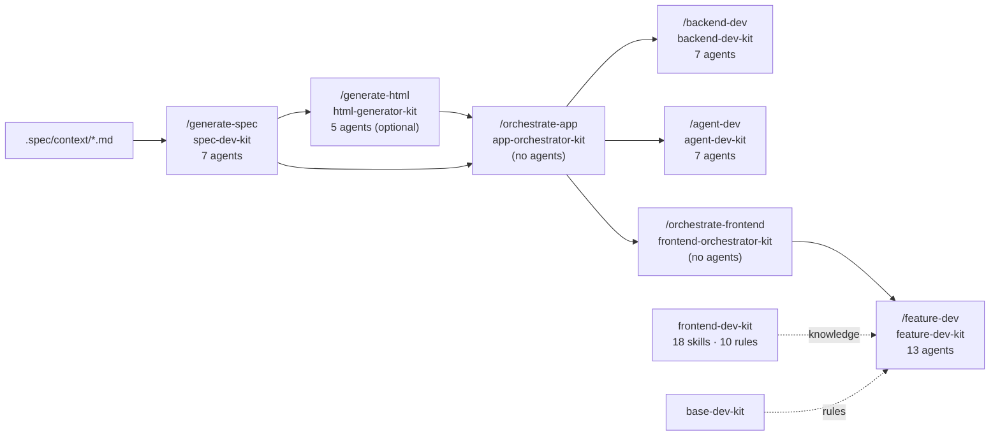

# 00 — Lessons from the current `app-dev-kit`

The new factory is a **clean-slate design**. The current `app-dev-kit` is not refactored in place — it is mined for lessons. This file records what it does today, what proved valuable, and what the new design must avoid.

## What exists today

Seven separately installed plugins plus two companions:

**State on disk:** `.spec/spec/<id>/spec.md` (YAML+MD), slice briefs, `.spec/prototype/…`, `.spec/app/work-plan.md`, `.spec/app/task-checklist.md`, per-feature blackboards `.spec/features/<slug>.md` + `<slug>.context/`, `.spec/app/current.json` pointer and `increments/INC-NNN.json`.

**Orchestration today:** each entry *skill* runs in the main chat, owns human questions, and spawns an **opus orchestrator subagent**, which itself spawns worker subagents. Orchestrators return typed packets (`CLARIFY`, `REVIEW`, `CONTINUE`, `ESCALATION`, …) and are re-spawned with `MODE: resume`.

## Keep — ideas that proved their value

| Idea | Where today | Carried into |
|---|---|---|
| Hand-offs are **file paths + a result envelope** (`kit-result.json`) | all kits | [06 envelope](06-artifacts-and-contracts.md#return-envelope) |
| A **pointer** to the current spec / prototype and **revertable increments** | `current.json`, `increments/INC-NNN.json` | [06 state](06-artifacts-and-contracts.md#state-files) |
| **`changes.json` ADDED / MODIFIED / REMOVED** driving delta rebuilds | `write-changes.mjs`, `delta-pages.mjs`, `build-checklist.mjs --changes` | [04 delta-spec](04-entry-modes-greenfield-brownfield.md#the-delta-spec) |
| **Replace LLM agents with scripts** where work is mechanical (7 agents were removed) | Optimization.md | [01 P3](01-principles.md#p3--scripts-decide-models-judge) |
| **Per-station timings** (`timings.jsonl`) | spec / feature kits | [12](12-observability-and-evals.md) |
| **Work cards** instead of whole-board reads (119 KB → ~35 KB) | `board.mjs` | [07 context packs](07-context-engineering.md#context-packs) |
| **Read-budget tripwire** in `npm run validate` | `validate-marketplace.mjs` | [07 budgets](07-context-engineering.md#budgets) |
| **No-model behaviour tests** of the whole flow | `emulate-incremental-app.mjs`, `mock-flow.mjs` | [12 control-plane tests](12-observability-and-evals.md#layer-1--control-plane-tests-no-model) |
| **Tiering** of work by size (patch / standard / full) | feature-dev | [03 task tiers](03-sdlc-pipeline.md#task-tiers) |
| **Clean-tree check** before every dispatch | feature-dev | [09 preconditions](09-quality-gates-and-loop-control.md#preconditions) |
| Spec as **YAML front matter + Markdown** with stable IDs | spec-dev-kit | [06 spec](06-artifacts-and-contracts.md#requirements-and-stories) |

## Stop — what made it inefficient

### 1. A two-level hub that relies on nested spawning
Skill → opus orchestrator *subagent* → worker subagents. Claude Code subagents cannot reliably spawn further subagents, and every level adds a cold-start context and a packet round-trip. **New design:** one hub, in the main session ([02](02-architecture.md#hub-and-spoke)).

### 2. Two orchestrators and three overlapping reviews
`app-orchestrator-kit` and `frontend-orchestrator-kit` both orchestrate; feature-dev runs `code-reviewer`, then `/code-review`, plus `architecture-auditor`. **New design:** one Conductor; one review stage with distinct lenses and no overlap ([09](09-quality-gates-and-loop-control.md#review-design)).

### 3. Mega-prompts and triple-stated pipelines
Agents of 300–400 lines (`html-orchestrator` 409, `spec-analyst` 403), SKILL.md files of 350–480 lines, and the station order written in SKILL.md, `pipeline-flow.md` *and* the orchestrator prompt. `spec-synthesizer` still loads ~1,650 lines per spawn. **New design:** the pipeline is defined **once, in config**; agents are ≤120 lines; procedures live in skills loaded on demand ([07](07-context-engineering.md)).

### 4. Copy-pasted runtime
`write-kit-result.mjs` ×7, `ensure-yaml.sh` ×7, `import-upstream.mjs` ×3, `run-gates.sh` ×3, the "resolve KIT_DIR" block in six skills. **New design:** one `factory-core` runtime; packs never copy core scripts ([10](10-configuration-and-extensibility.md#packaging)).

### 5. Uneven maturity between tracks
Backend and agent kits still use LLM "interpreter" and "quality-gate-runner" agents that feature-dev already replaced with scripts, and they never commit. **New design:** all role packs implement the same *role contract* and inherit the same gates and delivery ([05](05-agents-and-roles.md#the-role-contract)).

### 6. Rules that leak across roles
Backend / agent rules use `globs: **/*.{ts,mts}`, so they attach to frontend edits too; frontend rules run 228–253 lines each against a 40-line guideline. **New design:** stack-pack rules are scoped to the role's `owns_paths` ([10](10-configuration-and-extensibility.md#stack-packs)).

### 7. Strictly sequential, one feature per chat
Tracks run backend → agent → frontend; each feature requires "resume in a new chat"; worktrees are explicitly forbidden. Wall-clock grows linearly with feature count. **New design:** contract-first parallel role tracks in worktrees, and a headless runner that gives each step a fresh context automatically ([08](08-parallelism-and-flow.md)).

### 8. No brownfield onboarding
`context.existing-system` is free text; feature-dev refuses to work unless an FSD host already exists; nothing reverse-engineers an app into a spec. **New design:** a Discovery stage that builds an app-profile, capability index and baseline feature ledger ([04](04-entry-modes-greenfield-brownfield.md#discovery-stage)).

### 9. Missing gates
No hung-agent detection (polling was removed), no FE ↔ BE contract check, prototype skipped silently when declined. **New design:** Loop Warden budgets incl. wall-clock, contract conformance gate, explicit prototype trigger policy ([09](09-quality-gates-and-loop-control.md), [03](03-sdlc-pipeline.md#prototype-stage)).

### 10. Discoverability evals, but no behaviour evals
`evals/runner.mjs` checks that prompts *find* the right skill, not that the pipeline *produces* good output. **New design:** three eval layers including golden tickets replayed headless ([12](12-observability-and-evals.md)).

## Measured baseline to beat

From `app-dev-kit/Optimization.md`:

| Metric | Today | Target for the factory |
|---|---|---|
| One feature, agent wall-clock (`feature-dev` only, after spec) | ~4 h 40 m | < 1 h 30 m for a "standard" feature, S3–S8 (estimated 87 min in [15](15-walkthrough-and-estimates.md)) |
| Spec run | up to 3 h | < 45 min incl. clarification wait (estimated 18 min agent time in [15](15-walkthrough-and-estimates.md)) |
| Test station | ~40 min | < 15 min on the critical path (test strategy written up front; red phases pipelined behind builders, see [03](03-sdlc-pipeline.md#test-first-two-nested-loops)) |
| Review + fix replays | ~45 min | ≤ 1 fix cycle, < 20 min |
| Reference text per builder spawn | ~25 KB | ≤ 8 KB (context pack T0–T2) |
