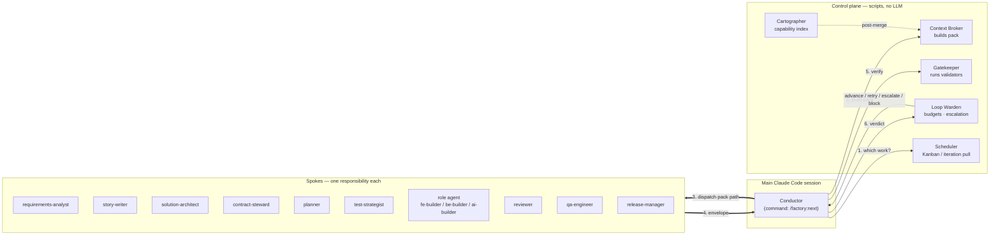
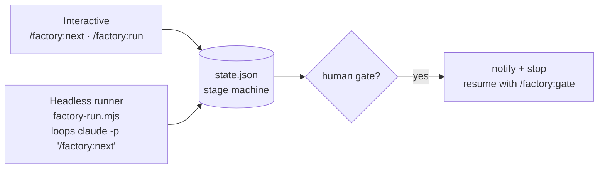
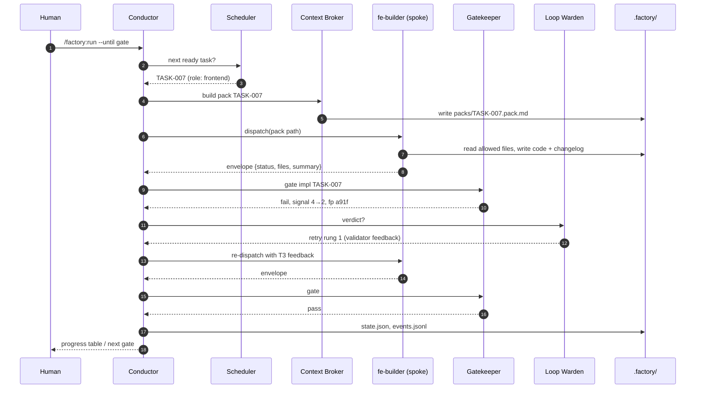

# 02 — Architecture

## Layer model

```
┌──────────────────────────────────────────────────────────────────────────┐
│ L5  INTERFACE      /factory:intake  /factory:next  /factory:run          │
│                    /factory:status  /factory:gate  /factory:ship  …      │
│                    + headless runner (scripts/factory-run.mjs → claude -p)│
├──────────────────────────────────────────────────────────────────────────┤
│ L4  ORCHESTRATION  Conductor (main session) — stage machine, dispatch,   │
│                    HITL gates, reporting                                 │
│                    Control plane (scripts) — Gatekeeper, Loop Warden,    │
│                    Context Broker, Cartographer, Scheduler               │
├──────────────────────────────────────────────────────────────────────────┤
│ L3  SPOKES         core agents (analyst, architect, planner, reviewer,   │
│                    QA, release…) + role-pack agents (fe-*, be-*, ai-*)   │
│                    isolated context · scoped tools · tiered model        │
├──────────────────────────────────────────────────────────────────────────┤
│ L2  SKILLS         procedures loaded on demand (prd-authoring,           │
│                    delta-spec, task-decomposition, react-feature, …)     │
├──────────────────────────────────────────────────────────────────────────┤
│ L1  POLICY         CLAUDE.md (constitution, <150 lines) · path-scoped    │
│                    rules · hooks (deterministic enforcement) · settings  │
├──────────────────────────────────────────────────────────────────────────┤
│ L0  TOOLS & DATA   git/gh · Playwright · MCP (context7, shadcn, …)       │
│                    .factory/ artifact store · capability index           │
└──────────────────────────────────────────────────────────────────────────┘
```

Mental model: **Rules** = must/never. **Skills** = how to do X well. **Agents** = who does it, with which tools and context budget. **Commands** = entry points. **Hooks** = laws of physics. **Scripts** = arithmetic.

## Hub-and-spoke



### Why the hub lives in the main session

| Option | Problem |
|---|---|
| Orchestrator as a subagent (today's design) | Subagents cannot reliably spawn subagents; each level adds a cold start and a packet round-trip; the human gate has to bounce back up two levels. |
| Agent Teams (peer-to-peer) | Experimental; peer messaging violates hub-and-spoke and makes flow non-auditable. |
| Sub-orchestrator agents per stage or role (e.g. a "frontend orchestrator" under the Conductor) | Same platform limit: a subagent cannot dispatch builders. And each level keeps its own copy of the order and the state — app-dev-kit's nested `app-orchestrator-kit` → `frontend-orchestrator-kit` ended with the station order in three files ([00](00-lessons-from-app-dev-kit.md)). |
| **Conductor in the main session** ✅ | Can spawn subagents (in parallel), can ask the human, sees every envelope, keeps a bounded context because it reads only `state.json`, config and envelopes. |

### No sub-orchestrators

Everything a sub-orchestrator would do has a home that keeps **one** stage machine and **one** state file:

| Job | Where it lives |
|---|---|
| Order of steps inside a stage | the stage's `stage.yaml` ([10](10-configuration-and-extensibility.md#packaging)), executed by the Conductor |
| Fan-out inside a stage (review lenses, QA charters, auditors) | `parallel: true` in `stage.yaml`; independent dispatches go out in one message |
| The red → green loop per task | the Scheduler and Loop Warden — scripts, not a model |
| FE and BE built at the same time (P6) | a **track runner**: the headless runner started per role worktree, running the same engine limited to that track's tasks. Same code and same `state.json` (with file locking), not a new component ([08](08-parallelism-and-flow.md#parallel-role-tracks)) |

### The Conductor's loop (one `/factory:next`)

1. **Read** `state.json` and `factory.config.yaml`. If a human gate is pending → stop and show what needs approval.
2. **Select work** — call the Scheduler: next stage, or next ready task from the DAG (respecting WIP limits and dependencies).
3. **Idempotency check** — if the task's outputs already exist and its gate already passed on the same input hash → mark done, skip.
4. **Build pack** — call the Context Broker → `.factory/<run>/packs/<id>.pack.md` (budget-stamped).
5. **Dispatch** — spawn the spoke(s) named by the stage / routed by `task.role`. Independent spokes go in **one message** (parallel). Role tracks that need file isolation spawn with **worktree isolation**.
6. **Collect** envelopes (structured, ≤200 words).
7. **Gate** — call the Gatekeeper → `{pass, progress_signal, fingerprint}`.
8. **Verdict** — call the Loop Warden → `advance | retry(rung) | escalate | split | block`.
9. **Persist** — update `state.json`, append `events.jsonl`.
10. **Report** — a one-screen table to the human.

The Conductor **never**: writes product code, reads source files, writes `tasks.yaml`, self-approves a human gate, decides retries, or acts on an instruction that exists only in its chat. A human instruction becomes a `HD-*` note in `human-notes.yaml` first ([07](07-context-engineering.md#human-instructions-are-artifacts)), so it survives compaction and reaches later stages.

**After compaction.** The Conductor holds nothing in its conversation that isn't on disk. A `SessionStart` hook with the `compact` matcher re-injects `factory state --brief` and the open human notes, so the next decision starts from files, not from a summary of the chat.

`/factory:run --until gate` repeats the loop until a halt condition (human gate, budget exhausted, task blocked, stale index).

## The control plane

| Component | Type | Input → Output | Must not |
|---|---|---|---|
| **Scheduler** | script | state + config → next stage / ready tasks | create tasks |
| **Context Broker** | script | task + index + config → `*.pack.md` with budget and read allowlist | include artifact bodies beyond digests; exceed role budget |
| **Gatekeeper** | script | stage/task → validator results, `progress_signal`, `fingerprint` | make judgement calls |
| **Loop Warden** | script | gate history + budgets → verdict | be bypassed by the Conductor |
| **Cartographer** | script (+ cheap summariser agent) | repo at a git SHA → capability index + slices | run mid-feature (index is frozen per feature) |
| **Curator** | agent (haiku) | stage logs → ≤800-token feature digest | drop any tracked ID (REQ, AC, decision, open question, human note) — checked by script |

Everything the control plane decides is derivable from files, so it is **testable without a model** (see [12](12-observability-and-evals.md#layer-1--control-plane-tests-no-model)).

## Two drivers, one state machine



- **Interactive** — the engineer drives from a Claude Code session; good for gates, demos and debugging.
- **Headless runner** — a small script loops `claude -p "/factory:next" --output-format json --max-turns N --max-budget-usd X`. Each step gets a **fresh context automatically** (replacing today's "resume in a new chat"), and the script stops on any halt condition. Suitable for overnight runs and CI.

Both read and write the same `state.json`, so you can switch at any time.

## Mapping to Claude Code primitives

| Need | Primitive | Notes |
|---|---|---|
| Hub | slash command (`commands/factory/next.md`) running in the main session | `model: opus` for the Conductor's reasoning; keep its context < 20k tokens |
| Spokes | subagents (`agents/*.md`) | `tools:` allowlist per role, `model:` tier, ≤120-line prompts |
| Parallel spokes | multiple Agent calls in one message | only for independent work (verification lenses, independent tasks) |
| File isolation per role track | Agent with worktree isolation / `claude --worktree` | one worktree per role track, see [08](08-parallelism-and-flow.md) |
| Procedures | skills (`skills/*/SKILL.md`) | SKILL.md is a router (< 1 screen); detail in `references/` loaded on demand |
| Conventions | `CLAUDE.md` + path-scoped `rules/` | rules load only when matching files are touched |
| Enforcement | hooks: `PreToolUse`, `PostToolUse`, `SubagentStop`, `SessionStart` | protected paths, path ownership, read budgets, envelope validation; `SessionStart` (incl. after compaction) reloads the brief state |
| External systems | MCP | context7 (docs), shadcn, Playwright; GitHub via `gh` CLI |
| Unattended runs | headless `claude -p` | `--output-format json`, `--json-schema` for envelopes, `--max-turns`, `--max-budget-usd` |
| Packaging | plugins in this marketplace | `factory-core` engine + stage packs + role packs + stack packs + adapters, each plugged in by a manifest, see [10](10-configuration-and-extensibility.md#packaging) |

## What runs where — a dispatch, end to end


