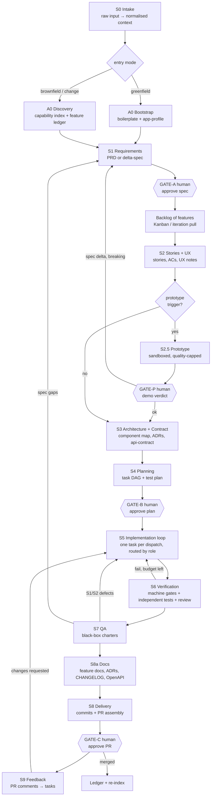
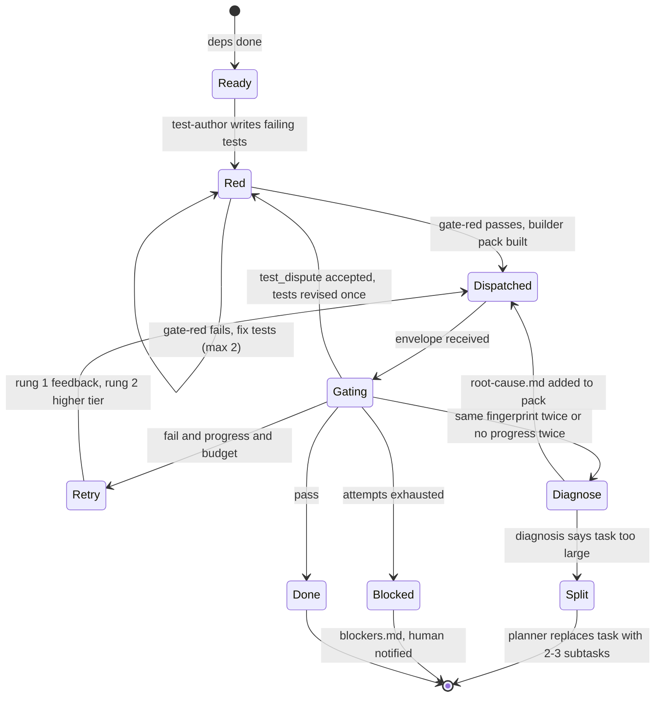

# 03 — The SDLC pipeline

One lifecycle per **feature** (a vertical slice of user value). An **app run** wraps many feature lifecycles and adds app-level stages (bootstrap or discovery) at the start. The flow policy — Kanban or iterations — decides *when* each feature enters the lifecycle ([08](08-parallelism-and-flow.md)).

## Stage graph

## Stage table

| Stage | Spokes | Reads | Writes | Machine gate | Human gate |
|---|---|---|---|---|---|
| **S0 Intake** | `intake-normaliser` (haiku) + script | `.factory/inbox/*` (any format) | `context/normalised/*.md`, `context/index.yaml` (source IDs, quotes) | every requirement-bearing sentence has a source ID | — |
| **A0 Bootstrap** *(greenfield)* | script + `solution-architect` | `factory.config.yaml`, boilerplate | app scaffold, `app-profile.yaml`, initial capability index | build + tests green on empty app | — |
| **A0 Discovery** *(brownfield)* | Cartographer + `codebase-analyst` | repository | `app-profile.yaml`, capability index, `feature-ledger.yaml` (baseline) | conformance check against stack pack | confirm baseline (once per app) |
| **S1 Requirements** | `requirements-analyst`, `interrogator` | normalised context, ledger | `prd.md` **or** `delta-spec.md`, `open-questions.md` | IDs present, ACs measurable, 0 blocker questions | **GATE-A** |
| **S2 Stories + UX** | `story-writer` | approved spec, capability index slice | `stories.yaml` (INVEST + Gherkin ACs), `ux-notes.md` | every story traces to REQ; ACs parse as Gherkin | — |
| **S2.5 Prototype** *(optional)* | `prototyper` (role pack) | stories, ux-notes, mock catalog | sandbox screens, `prototype-report.yaml` (spec_delta) | sandbox-only writes; renders; no new deps | **GATE-P** |
| **S3 Architecture + Contract** | `solution-architect`, `contract-steward` | stories, index slice, ADRs | `component-map.md`, `adr-*.md`, `api-contract.yaml` | contract lints; every component owned by a story; reuse decisions cited | — |
| **S4 Planning** | `planner`, `test-strategist` | all above | `tasks.yaml` (DAG, `role:` per task), `test-plan.md` | DAG acyclic; every AC → ≥1 test; tasks within size limit | **GATE-B** |
| **S5 Implementation** | per task: role test-author (**red**), then role builder (**green + refactor**), routed by `task.role`; `acceptance-test-author` once per feature at S5 start | one task's pack | failing tests first, then code, `changelog.md` entry | `gate-red` (new tests fail for the right reason), then `gate-impl` (tsc, lint, unit tests, build for touched scope; red tests unchanged) | — |
| **S6 Verification** | `reviewer` (lenses), auditors (a11y/perf/security, stack-specific); acceptance tests from S5 are run here | diff, task, ACs, test plan | `review.md`, audit JSONs | acceptance tests pass; coverage of changed lines; 0 P0/P1 findings; audits within thresholds; contract conformance | — |
| **S7 QA** | `qa-engineer` (black-box) | running build, stories, ACs | `defects.yaml`, `qa-report.md` | S1/S2 defects = 0 or waived | — |
| **S8a Docs** | `tech-writer` (haiku) + scripts (OpenAPI generation) | feature artifacts (spec, stories, ADRs, review), final diff | app repo: `docs/features/<FEAT>.md`, `docs/adr/ADR-*.md` (promoted), `CHANGELOG.md` entry, regenerated OpenAPI, touched README sections; `08-delivery/docs-report.md` | `gate-docs`: feature doc exists and lists every AC; each new ADR promoted; CHANGELOG entry present; OpenAPI regenerated when the contract changed | — |
| **S8 Delivery** | `release-manager` + script | feature folder, diff | commits, `pr.md`, opened PR | commitlint, PR template complete, CI green | **GATE-C** |
| **S9 Feedback** | `feedback-triager` | PR review comments (via `gh`) | new task nodes / spec questions | each comment classified | — |

### Starting a run: how context gets in

There are three ways to give the factory its input. All of them end as files in `.factory/inbox/`, so the rest of the pipeline never cares which one was used.

| Situation | You do | The factory does |
|---|---|---|
| You have documents (brief, emails, tickets, screenshots, a Figma export) | drop them in `.factory/inbox/`, run `/factory:intake` | normalises them, assigns source IDs, detects the mode |
| You have little or nothing written down | run `/factory:intake --interview` | runs a guided interview (below), saves answers as `inbox/interview-<date>.md` |
| A one-line change request | `/factory:intake --text "Checkout must accept coupon codes"` | saves the text as a source, usually routes to the **patch** or **standard** tier |

**Guided interview.** Subagents cannot talk to the human, so the `requirements-analyst` writes question batches to a file and the Conductor asks them in the main session (multiple-choice where possible, each with a suggested default).

- A coverage checklist drives it: problem and goal, users and roles, core flows, data and integrations, NFRs (performance, a11y, i18n, security), out of scope, existing systems, design input (theme, brand, mockups).
- At most 3 rounds of 5–8 questions. Anything still unknown becomes an open question with a default, decided at GATE-A.
- `gate-intake` also triggers it after a normal intake, when the checklist has blocker gaps.
- Interview answers are a source like any other document: they get source IDs and are traceable from the spec.

### Gate summary

Three mandatory human gates — **A (spec), B (plan), C (PR)** — plus optional **P (prototype)** and the once-per-app **baseline confirmation** in brownfield mode. Everything else is a machine gate. Rationale: requirement and design errors are the expensive ones; code errors are cheap once machine gates exist.

### Code review and documentation after implementation

- **Review** happens twice, by different reviewers. S6 is the machine one: gates first, then the seven-lens `reviewer` in a separate context, plus stack auditors ([09](09-quality-gates-and-loop-control.md#review-design)). GATE-C is the human one, on the GitHub PR. S9 then turns PR comments into fix tasks.
- **Documentation** is S8a: the factory's own artifacts stay in `.factory/features/<id>/` (committed), and the *app's* living docs are updated in the app repo — `docs/features/<FEAT>.md` (what the feature does, ACs, screens/endpoints, how to test), `docs/adr/` (decisions promoted from `03-architecture/`), `CHANGELOG.md`, OpenAPI, README sections. The PR carries both, so the reviewer sees docs next to code.

## Task tiers

Not every change deserves the whole pipeline. The Planner (or the intake classifier for tiny requests) assigns a tier; the tier selects a **pipeline profile** from config.

| Tier | Typical change | Stages run | Human gates |
|---|---|---|---|
| **patch** | copy change, style fix, one-file bug | S1-lite (delta note) → S5 → S6 (machine gates + lenses 1, 6) → S8 (CHANGELOG line only) | C |
| **standard** | a feature of ≤ ~6 tasks | full graph, prototype only if triggered | A, B, C |
| **full** | new route + new entity + contract change, or ≥ 7 tasks | full graph; prototype default-on; QA full charter | A, (P), B, C |

## Prototype stage

The prototype is **an instrument for discovering spec deltas**, not an early implementation (lesson from html-generator-kit, where the prototype grew into a design system of its own).

- **Trigger** (any): new user-facing surface; ≥ 2 net-new components; stakeholder alignment unconfirmed; UX confidence low. **Skip** (all): variation of an existing pattern; ≤ 3 points. Overrides: `/factory:proto --force | --skip` — never skipped *silently*.
- **Sandbox**: writes only to `prototypes/<feature>/` — enforced by a `PreToolUse` hook while `stage == prototype`. Fixtures only, no new dependencies, no tests/a11y/perf gates.
- **Implementation**: built with the app's real stack and design tokens (not a separate HTML world), so it looks like production. Plain-HTML mockups are an option for very early stakeholder work, but must use the same CSS/token package.
- **Deliverable**: `prototype-report.yaml` with `spec_delta` (validated / invalidated / discovered ACs), component inventory, and an asymmetric **promotion contract** — structure, markup and copy may be promoted; data layer, state, error handling, a11y, i18n and tests are always rebuilt.
- **Termination**: max 3 revisions, then a forced decision (approve / approve-with-changes / descope / abandon). If revision 1 produces an empty delta → stop early (`waste_flag: true`).
- **Backward edge**: a *breaking* delta returns to S1 for a narrow amendment, **once**.

## Test-first: two nested loops

Every behaviour-bearing change is built test-first. The factory enforces it with gates and hooks rather than asking agents to "please do TDD".

**Outer loop — acceptance (per feature).** Right after GATE-B, `acceptance-test-author` writes the feature's acceptance tests from the spec, the test plan and the contract only (no `src/` access). They must fail against the current app. They become the feature's finish line and are run at S6.

**Inner loop — red → green → refactor (per task).**

| Phase | Who | Allowed to write | Gate | Gate passes when |
|---|---|---|---|---|
| **Red** | role test-author (`fe-test-author`) | the task's test files + typed stubs of the target symbols (`throw new Error("not implemented")`) | `gate-red` | tests type-check; **every new test fails with an assertion or not-implemented error** (an import, syntax or type error does not count as red); all pre-existing tests still pass |
| **Green** | role builder (`fe-builder`) | the task's source files; **not** the red test files (hook) | `gate-impl` | all task tests pass; tsc, lint, build for touched scope; hash of red test files unchanged |
| **Refactor** | same builder dispatch, after green | source files | `gate-impl` re-run | still green; lint/complexity/duplication thresholds met |

Rules:

- The test-author reads the task's DoD, `satisfies` ACs and the matching test-plan cases — not a builder's draft. That is what makes the tests independent ([01](01-principles.md)).
- If the builder believes a red test is wrong, it returns `error.type: test_dispute` with evidence. The Conductor sends the dispute back to the test-author **once**; a second dispute goes to the human. The builder can never edit or skip a red test.
- **Change requests** start with characterisation tests: tests that pin current behaviour and pass on today's code. Only then come the red tests for the change.
- **Exempt task types** (`tdd: exempt` + reason, set by the planner and checked by `gate-plan` against a whitelist): script scaffolding, route/navigation wiring, copy and style-only patches, generated contract types. Visual correctness is covered by QA's visual-regression charter, not by unit tests.
- **Pipelining hides the extra dispatch.** While the builder works on task N, the test-author may write red tests for the next ready task, because test files are disjoint and `gate-impl` runs only the current task's tests. See the timing in [15](15-walkthrough-and-estimates.md).

## The implementation loop (S5 ↔ S6) in detail

**QA overlaps review.** S7 needs only a running build, so it starts as soon as S6's machine gates pass, in parallel with the review lenses. If a review fix changes code, QA re-runs only the charters that touch the changed screens.

Details of the ladder, fingerprints and budgets: [09](09-quality-gates-and-loop-control.md#loop-warden).

## Commands (L5)

| Command | Purpose |
|---|---|
| `/factory:intake [path] [--interview] [--text "…"]` | Ingest new files from `.factory/inbox/` (or run the guided interview, or take a one-line request), detect mode, create a run |
| `/factory:next [feature]` | Advance exactly one stage or one task |
| `/factory:run --until gate` | Advance until a halt condition |
| `/factory:status` | Stages, gates, WIP lanes, budgets, blocked items |
| `/factory:gate approve\|reject [notes]` | Resolve the pending human gate; notes are stored as `HD-*` entries in `human-notes.yaml` |
| `/factory:note "<text>" [--feature <id>]` | Record an instruction between gates; the Conductor never acts on chat-only instructions ([07](07-context-engineering.md#human-instructions-are-artifacts)) |
| `/factory:proto --force\|--skip` | Override the prototype trigger |
| `/factory:replay <stage> --with "<feedback>"` | Re-run a stage with human feedback |
| `/factory:diagnose <task>` / `/factory:split <task>` | Jump to escalation rung 3 / 4 |
| `/factory:ship` | Run S8 (commits + PR) for a verified feature |
| `/factory:index [--force]` | Rebuild the capability index (post-merge) |
| `/factory:abort <feature>` | Terminal stop with post-mortem |
