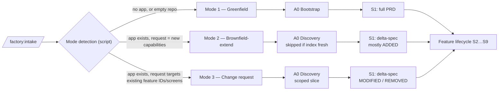

# 04 — Entry modes: greenfield, brownfield-extend, change request

The factory must know **what already exists** before it plans anything. The three modes differ only in how the app-level context is established and how requirements are expressed; after that, every feature follows the same lifecycle ([03](03-sdlc-pipeline.md)).



**Mode detection** is deterministic: does `.factory/app-profile.yaml` exist? Is the capability index fresh for the current `HEAD`? Does the normalised request reference existing feature IDs, routes or screens in the ledger? The Conductor shows the detected mode in GATE-A so the human can correct it.

---

## Mode 1 — Greenfield

1. **Boilerplate selection.** `factory.config.yaml` names a boilerplate per enabled role (e.g. `react-fsd-starter`). A script clones / scaffolds it — no tokens spent.
2. **App profile.** The `solution-architect` writes `app-profile.yaml` from the PRD's high-level view: goal, scope / out-of-scope, major components, NFR budgets, enabled roles and stacks.
3. **Design foundation (optional, once).** If no brand/theme input exists, a design-direction step produces a small intent spec and the stack pack's script generates tokens (see the *Design Lab* idea in [14](14-risks-and-open-questions.md#open-questions)). If a theme is provided, it is **binding**.
4. **Baseline index.** The Cartographer indexes the empty app so that the very first feature already benefits from reuse checks.
5. **Backlog.** The PRD is decomposed into features (vertical slices) with dependencies — e.g. *auth → catalogue → cart → checkout*. The flow policy pulls them one by one or per iteration.

Each merged feature appends to the **feature ledger** and triggers re-indexing — so feature N+1 is planned against the app *as it really is*, not as the PRD imagined it.

---

## Mode 2 — Brownfield-extend

> "I already built an app with this pipeline (or by hand, with the same architecture). Add features without rewriting what exists."

### Discovery stage

Runs once per app and again only when the index is stale (`index_sha != HEAD`). Mostly scripts; one analyst agent for summaries.

| Step | Tool | Output |
|---|---|---|
| Structure scan | script (AST / route / import graph) | modules, layers, routes, public APIs |
| Component inventory | script + haiku summariser | `component-inventory.yaml` (path, props digest, capabilities, usage count, `do_not_fork`) |
| Capability map | script + `codebase-analyst` | `capability-map.yaml` — feature → routes → modules → owning role |
| Pattern detection | script | which golden-file patterns are used where; deviations list |
| Test baseline | script | which modules have tests, which flows have e2e; coverage snapshot |
| Feature ledger (baseline) | `codebase-analyst` | `feature-ledger.yaml` — one entry per existing feature with routes, entities and test pointers; marked `origin: discovered` |
| Conformance check | script against the stack pack's architecture rules | `conformance.yaml`: **conformant / partially / non-conformant** |

**Conformance matters.** The factory's stack packs assume an architecture (e.g. React + FSD). If the app is:

- **conformant** → full mode;
- **partially conformant** → full mode for new slices; edits to non-conformant areas run in *adapter mode* (follow local patterns, no refactor unless a task says so) and are flagged in review;
- **non-conformant** → adapter mode only, or a human decision to run a separate "align architecture" epic first.

The human confirms the baseline once (the ledger is the factory's memory of what exists — it must be right).

### Requirements as a delta

In brownfield mode S1 produces a **delta-spec**, not a fresh PRD. The analyst receives the relevant capability-map slice and ledger entries so it can say "this already exists" instead of re-specifying it.

### Reuse-before-build

Gates at S3 and S4 require every net-new component / hook / entity / endpoint to carry `reuse_rejected: <inventory entry> — <reason>`. Duplicates found by the post-merge index diff are reported as regressions.

---

## Mode 3 — Change request

> "Checkout must support coupons." / "Remove the legacy export screen."

1. **Scoped discovery** — the Cartographer returns only the slice for the affected feature(s): files, tests, routes, contract endpoints, ledger history.
2. **Delta-spec** with honest REMOVED accounting (below).
3. **Characterisation tests first** — before any edit to existing behaviour, a test task captures current behaviour of the touched paths (where tests are missing). The task DAG enforces `characterise → modify`.
4. **Behaviour-preservation review lens** is mandatory: every behaviour change in the diff must trace to a MODIFIED/REMOVED item.
5. The ledger entry of the feature is **versioned**, not replaced (`FEAT-012@v2`).

---

## The delta-spec

The single most important artifact for not rewriting working software.

```yaml
# .factory/features/FEAT-021/01-requirements/delta-spec.yaml
feature: FEAT-021
mode: change-request
base: { ledger: FEAT-012@v1, index_sha: 9f2c1ab }
summary: "Support coupon codes at checkout"

added:
  - id: REQ-0412
    text: "User can apply one coupon code per order"
    acs: [AC-0901, AC-0902]
modified:
  - id: REQ-0133               # existing requirement
    before: "Order total = sum(lines) + shipping"
    after:  "Order total = sum(lines) - discount + shipping; discount >= 0"
    affected: [src/entities/order/model/total.ts, e2e/checkout.spec.ts]
removed: []                    # MUST be present; empty means "confirmed nothing removed"
unchanged_guarantees:          # explicitly protected behaviours
  - "Totals are rounded half-even to 2 decimals"
open_questions:
  - { id: OQ-31, severity: major, text: "Stackable with loyalty discount?", default: "no" }
```

Rules:

- `removed` is **mandatory**, even when empty — its presence forces the human at GATE-A to confirm nothing disappears.
- Every `modified.affected` path must exist in the capability index (gate check) — no phantom files.
- `unchanged_guarantees` become regression tests if not already covered.

## How the factory "knows what was already done"

| Question | Answered by |
|---|---|
| Which features exist and where? | `feature-ledger.yaml` + `capability-map.yaml` |
| Which components can I reuse? | `component-inventory.yaml` |
| What changed since the index was built? | `index.meta.json` SHA vs `HEAD` → Cartographer re-runs before planning |
| Was this feature already started? | `state.json` per feature + idempotency checks per task (outputs exist + gate passed on same input hash → skip) |
| Which spec version is current? | `current.json` pointer + revertable increments (kept from app-dev-kit) |

## Mode-specific pipeline differences (summary)

| | Greenfield | Brownfield-extend | Change request |
|---|---|---|---|
| A0 | Bootstrap | Discovery (full, cached) | Discovery (scoped slice) |
| S1 artifact | PRD | delta-spec (mostly ADDED) | delta-spec (MODIFIED / REMOVED) |
| Prototype default | on for new surfaces | trigger rules | off unless UI changes substantially |
| Extra S4 tasks | — | reuse checks | characterisation tests first |
| Extra review lens | — | duplication | behaviour preservation (mandatory) |
| Ledger | new entry | new entry | new version of existing entry |
