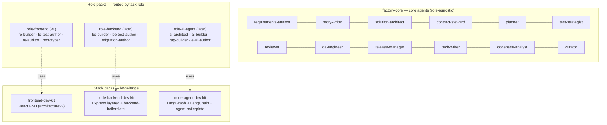

# 05 — Agents, role packs and stack packs

Three kinds of components, separated so each can evolve on its own:

| Kind | Answers | Example | Changes when |
|---|---|---|---|
| **Core agents** | *What* to build and *whether* it is right — role-agnostic SDLC work | requirements-analyst, planner, reviewer, qa-engineer | SDLC process changes |
| **Role packs** | *How a developer of this role executes a task* | `role-frontend`: fe-builder, fe-test-author, fe-auditor | a new developer role is added |
| **Stack packs** | *What the code must look like in this technology* | `frontend-dev-kit`, `node-backend-dev-kit`, `node-agent-dev-kit`: rules, skills, golden files, a boilerplate | the tech stack changes |

A **role** pairs with one **stack** per project in config: `frontend → frontend-dev-kit` (React FSD) today, maybe a Vue stack in another project — without touching the role pack. The reference architecture each stack pack enforces is listed in [10](10-configuration-and-extensibility.md#reference-architectures).



## Core roster (v1: 14 agents)

Kept deliberately small. Split an agent only when you can state a crisp, non-overlapping trigger (anti-sprawl rule).

| Agent | Stage | Model tier | Tools (allowlist) | Single responsibility | Must not |
|---|---|---|---|---|---|
| `intake-normaliser` | S0 | haiku | Read, Write | Convert raw inputs to normalised Markdown with source IDs and quotes | interpret or invent requirements |
| `codebase-analyst` | A0 Discovery | sonnet | Read, Grep, Glob (scoped), Write | Summarise index output into capability map + baseline ledger | edit code |
| `requirements-analyst` | S1 | opus | Read, Write | PRD or delta-spec: IDs, measurable ACs, open questions with defaults | propose technical solutions; invent business rules |
| `story-writer` | S2 | sonnet | Read, Write | INVEST stories, Gherkin ACs, UX notes; trace each to REQ | change requirements |
| `solution-architect` | A0, S3 | opus | Read, Write, Grep (index-scoped) | Component map, ADRs, reuse decisions | write code |
| `contract-steward` | S3 | sonnet | Read, Write | Own `api-contract.yaml` (+ mocks); arbiter of the FE/BE seam | let a role edit the contract unilaterally |
| `planner` | S4 | opus | Read, Write | Task DAG with `role`, `files_expected`, DoD, `satisfies` | implement; exceed task size limits |
| `test-strategist` | S4 | sonnet | Read, Write | Test plan: AC → test cases, levels, data needs | read implementation |
| `acceptance-test-author` | S5 start (written), S6 (run) | sonnet | Read, Write (tests only), Bash | Write failing acceptance tests **from the spec only**, right after GATE-B | read `src/` (hook) |
| `reviewer` | S6 | opus | Read, Grep (diff-scoped) | Seven-lens review of the diff vs spec/ADRs; severity-tagged findings | fix code |
| `qa-engineer` | S7 | sonnet | Read, Write, Bash, Playwright MCP | Black-box charters against the running build; defects vs spec gaps | read `src/` (hook); create tasks |
| `tech-writer` | S8a | haiku | Read, Write (docs only) | Update the app's living docs from the feature's artifacts: `docs/features/<FEAT>.md`, promoted ADRs, OpenAPI, CHANGELOG, README sections | edit product code |
| `release-manager` | S8, S9 | haiku | Read, Write, Bash (`git`, `gh`) | Commit grouping, PR body from templates, PR comment triage | edit product code |
| `curator` | stage exit | haiku | Read, Write | ≤800-token feature digest | drop decisions / open questions |

The `interrogator` used by today's spec kit becomes a **skill** used by `requirements-analyst` (batched questions), not a separate agent.

### Agent prompt shape (≤120 lines)

```markdown
---
name: planner
description: Turns approved stories and architecture into a task DAG with role routing, DoD and test mapping. Use at stage "planning" or when the Conductor asks to split a task.
tools: Read, Write
model: opus
---
You produce `tasks.yaml` for ONE feature. You never write code.

## Inputs (from your context pack only)
stories.yaml · component-map.md · api-contract.yaml · capability slice · role registry

## Procedure
1. Load skill `task-decomposition`.
2. One task = one role, ≤3 files, ≤200 LOC, independently verifiable.
3. Order: contract/types → skeleton → logic → wiring (structure before logic).
4. Every net-new artefact cites `reuse_rejected`.
5. Run `factory gate plan <feature>` and include its output.

## Return envelope
{status, artifacts_written[], gate_result, summary<=200w, open_questions[]}
```

Procedure detail lives in the skill, conventions in rules, examples in golden files — **not** in the agent prompt.

## Role packs

A role pack is a plugin that implements the **role contract** for one kind of developer.

### The role contract

Every role pack must provide:

| Item | Purpose |
|---|---|
| `role.yaml` | name, `owns_paths` globs, task types it accepts, default stack, budgets |
| **builder agent** | implements exactly one task from a pack |
| **test-author agent** | writes unit/integration tests for a task (white-box, same role) |
| **auditor** (agent or scripts) | role-specific checks (FE: a11y, bundle; BE: migration dry-run, OpenAPI conformance; AI: eval suite) |
| **gate scripts** | `gate-impl`, `gate-verify` for the role (tsc/lint/test/build or equivalent) |
| **task-type procedures** | skills such as `fe-implement-component`, `be-implement-endpoint` |
| **prototyper** *(optional)* | for roles with a visible surface |
| **boilerplate pointer** | used by A0 Bootstrap |

The Conductor knows nothing about a role except this contract. Routing is a lookup:
`task.role → registry → builder agent + gate scripts + budgets`.

### role-frontend (v1)

| Agent | Tier | Responsibility |
|---|---|---|
| `fe-test-author` | sonnet | **Red phase**: colocated unit/component tests for the task's ACs plus typed stubs, written *before* the builder runs; characterisation tests for change requests. Never writes implementation |
| `fe-builder` | sonnet | **Green + refactor**: implement one task (component / hook / entity / feature / page / route) until the red tests pass, matching golden files. Cannot edit the red tests (hook) |
| `fe-auditor` | haiku + scripts | axe, bundle budget, i18n keys, token usage (no raw colours) |
| `prototyper` | sonnet | Sandbox screens for S2.5 |

Why one `fe-builder` instead of today's six layer engineers (shared/entities/features/composition/app/slice)? The *layer* is a property of the task, not of the agent. The task's `type` selects the procedure skill (`create-entity`, `create-feature`, …) and the golden file; the agent stays the same. Fewer agents → cleaner routing, fewer near-duplicate prompts.

### role-backend (later)

`be-builder`, `be-test-author` (supertest / integration), `migration-author` (always paired with a rollback; irreversible ops require human approval), auditor scripts (OpenAPI conformance against `api-contract.yaml`, migration dry-run).

### role-ai-agent (later)

`ai-architect` (opus — graph topology, state schema, tool design), `ai-builder` (LangGraph.js graphs, nodes and tools), `rag-builder` (ingestion, hybrid retrieval), `eval-author` (golden datasets + scorer config). Its gate adds an **eval run** with thresholds — the AI-feature equivalent of tests. Stack: `node-agent-dev-kit`; new services start from `agent-boilerplate`.

All three share the same lifecycle, gates framework, delivery and observability. That is what "handled in the same way" means.

## Stack packs

A stack pack is knowledge only — no agents:

- **Rules** — short (≤40 lines each), path-scoped to the role's `owns_paths`.
- **Golden files** — one exemplar per pattern, referenced by context packs.
- **Scaffolding skills + scripts** — deterministic generation (`create-slice.mjs`, `add-route.mjs`), so tokens are spent on logic, not boilerplate.
- **Validators** — architecture conformance (e.g. FSD import rules), used by Discovery and gates.
- **Index adapters** — how the Cartographer recognises routes, components and entities in this stack.

The frontend stack pack is today's `frontend-dev-kit` (18 skills, 10 rules), slimmed to the 40-line rule budget; its reference architecture is `docs/frontend/architecturev2` (FSD six layers), which its `architecture-audit` skill already checks. The backend and agent stack packs exist as `node-backend-dev-kit` and `node-agent-dev-kit`, each with a verified starter (`backend-boilerplate/`, `agent-boilerplate/`) that A0 Bootstrap clones.

## Model tiering

| Tier | Use for | Agents |
|---|---|---|
| **opus** (reasoning) | ambiguity, design, decomposition, review | requirements-analyst, solution-architect, planner, reviewer, ai-architect, Conductor |
| **sonnet** (execution) | implementation, tests, stories, QA | builders, test authors, story-writer, contract-steward, qa-engineer |
| **haiku** (mechanical) | normalising, summarising, triage | intake-normaliser, curator, release-manager, auditors |

The Loop Warden may **escalate** a sonnet task to opus at rung 2 ([09](09-quality-gates-and-loop-control.md#loop-warden)). Tiers live in config (`model_tiers`), and Cursor ids are mapped by a generator (as today's `model-tiers.json`).

## Tool scoping (enforced, not requested)

| Rule | Enforcement |
|---|---|
| Each agent ≤ 5 tools relevant to its role | `tools:` allowlist in frontmatter |
| Builders write only their task's `files_expected` (+ colocated tests) | `PreToolUse` hook reads the active pack |
| Roles write only inside `owns_paths` | `PreToolUse` hook + role registry |
| QA and acceptance-test-author cannot read `src/**` | `PreToolUse` hook |
| No unscoped `Grep`/`Glob` | `PreToolUse` hook requires a path inside the pack's allowlist |
| Only the planner writes `tasks.yaml` | `PreToolUse` hook |
