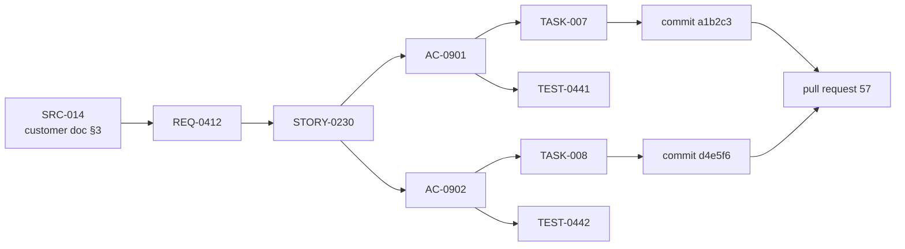

# 06 — Artifacts and hand-off contracts

The artifact store is the factory's memory and the only channel between spokes. Every file has a schema in `factory/schemas/`, validated by a `PostToolUse` hook on write and again by the stage gate.

## `.factory/` layout

```
.factory/
├── factory.config.yaml              # pipeline, roles, stacks, thresholds, budgets (see 10)
├── app-profile.yaml                 # Why / What / How of the app (high-level view)
├── current.json                     # pointer: active spec version, prototype, next IDs
├── state.json                       # app-level state: mode, backlog, WIP lanes, iteration
├── events.jsonl                     # append-only audit trail (see 12)
├── inbox/                           # customer / user input dropped here (any format)
├── context/
│   ├── normalised/*.md              # intake output, each paragraph with a source ID
│   └── index.yaml                   # source registry: file, author, date, hash
├── _index/                          # capability index — Cartographer output (see 07)
│   ├── index.meta.json              # git sha, generated_at
│   ├── capability-map.yaml
│   ├── component-inventory.yaml
│   ├── patterns.md
│   ├── mock-catalog.yaml
│   └── slices/<domain>.slice.md
├── ledger/
│   ├── feature-ledger.yaml          # every delivered / discovered feature, versioned
│   └── decisions/ADR-*.md           # architecture decisions (cold context)
├── increments/INC-NNN.json          # revertable spec increments (kept from app-dev-kit)
└── features/
    └── FEAT-021-coupons/
        ├── state.json               # feature stage machine, tasks, budgets, strikes
        ├── digest.md                # curator's rolling ≤800-token summary
        ├── human-notes.yaml         # HD-* instructions from gates and /factory:note (see 07)
        ├── 01-requirements/   prd.md | delta-spec.yaml, open-questions.md
        ├── 02-stories/        stories.yaml, ux-notes.md
        ├── 02b-prototype/     prototype-report.yaml
        ├── 03-architecture/   component-map.md, adr-*.md, api-contract.yaml
        ├── 04-plan/           tasks.yaml, test-plan.md
        ├── 05-impl/           changelog.md, deviations.md
        ├── 06-verify/         review.md, audits/*.json, gate-log.jsonl
        ├── 07-qa/             charters.yaml, defects.yaml, qa-report.md, evidence/
        ├── 08-delivery/       pr.md, provenance.md, docs-report.md
        ├── packs/             TASK-007.pack.md …   (context packs, see 07)
        └── envelopes/         TASK-007.a2.json …   (spoke results)
```

`.factory/` is committed to git (except `packs/` and `envelopes/`, which are reproducible and gitignored). That makes the factory's memory reviewable and diffable, and lets a second engineer — or a fresh session — continue exactly where the last one stopped.

## Requirements lifecycle

What happens to the customer's words, step by step:

| Step | Artifact | ID | Written by | Checked by |
|---|---|---|---|---|
| Raw input | `inbox/*` (any format) or interview answers | — | you | — |
| Human note | `human-notes.yaml`: gate notes and `/factory:note` | `HD-#` | you (via commands) | `gate-plan` (mapped), `gate-ready-for-pr` (none open) |
| Normalised source | `context/normalised/*.md`, each paragraph quoted with its origin | `SRC-###` | `intake-normaliser` | `gate-intake` (coverage, source IDs) |
| Requirement | `prd.md` (greenfield) or `delta-spec.yaml` (ADDED / MODIFIED / REMOVED), each with measurable ACs and open questions | `REQ-###`, `AC-###` | `requirements-analyst` | `gate-spec`, **GATE-A** |
| Story | `stories.yaml` (INVEST, Gherkin ACs), `ux-notes.md` | `STORY-###` | `story-writer` | `gate-stories` |
| Task | `tasks.yaml` (`role`, `type`, `satisfies`, DoD, `tdd`) | `TASK-###` | `planner` | `gate-plan`, **GATE-B** |
| Test | red tests per task, acceptance tests per feature | `TEST-###` | test-authors | `gate-red`, `gate-verify` |
| Code + commit | one commit per task with `Factory-Task` / `Factory-ACs` trailers | commit SHA | builder + script | `gate-impl`, `gate-ready-for-pr` |
| Docs | `docs/features/<FEAT>.md`, CHANGELOG, OpenAPI | — | `tech-writer` | `gate-docs` |
| PR | spec-trace table AC → test → status | PR number | `release-manager` | **GATE-C** |

Nothing downstream may introduce a requirement that has no `SRC-###` or `HD-#` upstream; the reviewer's spec-drift lens and the trace table in the PR make that visible.

## Traceability chain



Gates check every link: no REQ without a source, no AC without a test, no task without `satisfies`, no commit without a task ID trailer.

## Key schemas (sketches)

### App profile

```yaml
# .factory/app-profile.yaml
name: acme-portal
goal: "Self-service portal for B2B customers to order and track spare parts"
scope:   [catalogue, cart, checkout, order-tracking, account]
out_of_scope: [payments-provider-admin, mobile-native]
components:
  frontend: { stack: frontend-dev-kit, path: "apps/web" }
  backend:  { stack: node-backend-dev-kit, path: "apps/api", enabled: false }
  ai-agent: { stack: node-agent-dev-kit, path: "apps/agents", enabled: false }
nfr:
  web_vitals: { lcp_ms: 2500, inp_ms: 200 }
  a11y: WCAG_2.2_AA
  browsers: [chrome>=120, safari>=17, firefox>=120]
conformance: conformant            # from Discovery (brownfield)
origin: greenfield                 # greenfield | discovered
```

### Requirements and stories

PRD and delta-spec are **YAML front matter + Markdown** (kept from spec-dev-kit). Delta-spec example: [04](04-entry-modes-greenfield-brownfield.md#the-delta-spec).

```yaml
# 02-stories/stories.yaml
feature: FEAT-021
stories:
  - id: STORY-0230
    traces: [REQ-0412]
    as_a: "returning customer"
    i_want: "to apply a coupon code at checkout"
    so_that: "I get my negotiated discount"
    acs:
      - id: AC-0901
        gherkin: |
          Given a cart with total 100.00 EUR
          When I apply the valid coupon "B2B10"
          Then the discount line shows -10.00 EUR
          And the order total is 90.00 EUR plus shipping
      - id: AC-0902
        gherkin: |
          Given a cart
          When I apply an expired coupon
          Then I see "This coupon has expired" and the total is unchanged
    ux: { surfaces: [CheckoutSummary], states: [empty, applied, invalid, loading] }
```

### API contract (the FE/BE seam)

`api-contract.yaml` is **OpenAPI 3.1**, owned by the `contract-steward`. Even in the frontend-only phase the frontend builds against it with generated mocks, so that adding the backend later is an integration, not a rewrite.

```yaml
paths:
  /carts/{cartId}/coupon:
    put:
      operationId: applyCoupon
      x-factory: { feature: FEAT-021, acs: [AC-0901, AC-0902], owner_role: backend }
      requestBody: { content: { application/json: { schema: { $ref: '#/components/schemas/ApplyCoupon' } } } }
      responses:
        '200': { description: Applied, content: { application/json: { schema: { $ref: '#/components/schemas/Cart' } } } }
        '422': { description: Invalid or expired, content: { application/problem+json: { schema: { $ref: '#/components/schemas/Problem' } } } }
```

Changing the contract after GATE-B requires an ADR and an impact note for every role that consumes it.

### Task DAG — the routing seam

```yaml
# 04-plan/tasks.yaml   (written ONLY by the planner)
feature: FEAT-021
tasks:
  - id: TASK-005
    role: frontend               # ← routing key → role registry → builder agent
    type: entity-model           # ← selects the procedure skill + golden file
    title: "Add discount to order total calculation"
    depends_on: []
    satisfies: [AC-0901]
    files_expected:
      - src/entities/order/model/total.ts
      - src/entities/order/model/total.test.ts
    tdd:
      mode: required             # required | exempt (+ reason, whitelisted types only)
      red_tests: [src/entities/order/model/total.test.ts]   # written by fe-test-author, read-only for fe-builder
      stubs: ["calculateTotal(lines, discount, shipping): Money"]
    reuse: { considered: [entities/order], reuse_rejected: null }
    definition_of_done:
      - "total = sum(lines) - discount + shipping; discount clamped >= 0"
      - "Half-even rounding preserved (unchanged guarantee)"
    size: { files: 2, est_loc: 60 }
    tier: standard
  - id: TASK-007
    role: frontend
    type: feature-ui
    title: "CouponField in CheckoutSummary"
    depends_on: [TASK-005, TASK-006]
    satisfies: [AC-0901, AC-0902]
    files_expected:
      - src/features/apply-coupon/ui/CouponField.tsx
      - src/features/apply-coupon/ui/CouponField.test.tsx
    reuse:
      considered: [shared/ui/Input, shared/ui/InlineError]
      reuse_rejected: null       # reuses both
    contract_ops: [applyCoupon]  # FE consumes; mock generated from api-contract
  - id: TASK-009
    role: backend                # ignored (queued as "role disabled") until backend is enabled
    type: endpoint
    title: "PUT /carts/{cartId}/coupon"
    contract_ops: [applyCoupon]
```

Statuses (`pending | ready | in_progress | blocked | done | skipped_idempotent`) live in the feature's `state.json`, not in `tasks.yaml` — so the plan stays a stable, reviewable artifact.

### Context pack

See [07](07-context-engineering.md#context-packs) for the tiered format.

### Return envelope

Every spoke returns this — validated by a `SubagentStop` hook (missing fields or > 200-word summary → the spoke is asked to re-emit). It is the successor of today's `kit-result.json`.

```json
{
  "pack_id": "FEAT-021/TASK-007/a2",
  "status": "done",                       // done | failed | needs_scope_change | needs_clarification | blocked
  "artifacts_written": ["src/features/apply-coupon/ui/CouponField.tsx", "…test.tsx"],
  "gate_result": { "cmd": "factory gate impl FEAT-021 TASK-007", "pass": true },
  "summary": "≤200 words",
  "deviations": [{ "what": "used InlineError instead of Toast", "why": "AC-0902 requires inline message" }],
  "open_questions": [],
  "follow_up_suggested": [],             // advisory only — never becomes a task automatically
  "error": null                          // when failed: {type: transient|validation|business|permission, attempted, partial_results, alternatives}
}
```

The structured `error` block follows the four error categories, so the Loop Warden can decide: transient → retry; validation → retry with feedback; business → never retry, escalate; permission → human.

### Review and defects

```yaml
# 06-verify/review.md front matter
findings:
  - id: RV-3
    lens: hidden-assumptions          # behaviour | assumptions | spec-adr-drift | tests | edge-cases | security | over-engineering
    severity: P1                      # P0 blocker … P3 nit
    file: src/features/apply-coupon/model/useApplyCoupon.ts
    line: 42
    claim: "422 response assumed to always contain `detail`"
    evidence: "api-contract Problem.detail is optional"
    fix_hint: "Fall back to generic message"
```

`defects.yaml` (from QA) separates `type: defect` (→ builder) from `type: spec_gap` (→ requirements-analyst). Severity S1–S5 drives the triage policy in [09](09-quality-gates-and-loop-control.md#qa-and-defect-triage).

### State files

```jsonc
// features/FEAT-021/state.json
{
  "feature": "FEAT-021", "mode": "change-request", "tier": "standard",
  "stage": "implementation",
  "index_sha": "9f2c1ab",
  "awaiting_human": null,                            // "GATE-B" when waiting
  "gates": { "GATE-A": { "result": "approved", "by": "artsiom", "at": "…" } },
  "tasks": {
    "TASK-007": {
      "status": "in_progress", "attempts": 2, "rung": 1,
      "progress_signal": [4, 2], "fingerprints": ["c71e", "a91f"],
      "state_hashes": ["4b1d", "8e02"], "worktree": "wt/frontend-FEAT-021"
    }
  },
  "budgets": { "tokens": { "used": 812400, "max": 2500000 },
               "dispatches": { "used": 19, "max": 60 },
               "wall_clock_min": { "used": 71, "max": 240 },
               "regressions": { "used": 1, "max": 4 } },
  "halts": []
}
```

Anything an orchestrator decides is derivable from this file. That is what makes the factory resumable after a crash, debuggable without a model, and testable in CI.
