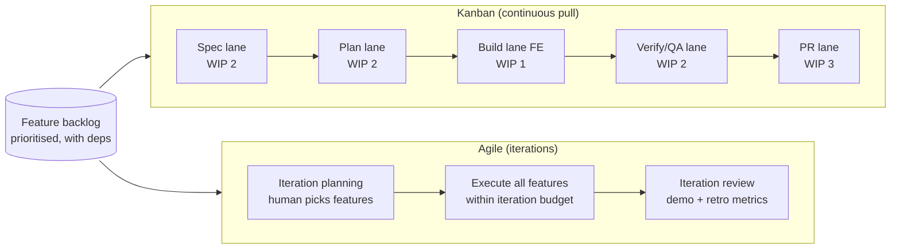
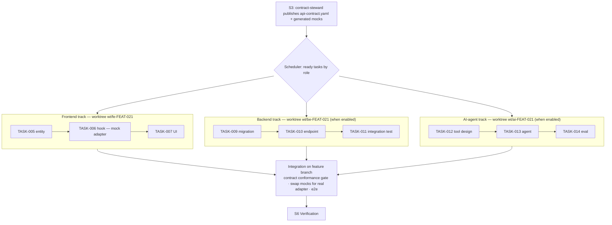

# 08 — Parallelism and flow (Kanban, Agile, worktrees)

Two separate questions:

1. **Flow policy** — *when* does a feature enter the lifecycle, and how many run at once?
2. **Parallel execution** — *inside* a feature, which work can run simultaneously, and how is it isolated?

## Flow policies

Both policies feed the same per-feature lifecycle ([03](03-sdlc-pipeline.md)). The **Scheduler** script implements them; the Conductor just asks "what's next?".



| | **Kanban** | **Agile iterations** |
|---|---|---|
| Entry | pull next highest-priority *ready* feature when a lane has capacity | features committed at iteration planning (human gate) |
| Limits | WIP per lane (per role for build lanes) | iteration token/time budget + feature count |
| Human cadence | gates as they come (A/B/C per feature) | gates batched: specs approved together at planning; PRs reviewed together at iteration review |
| Good for | steady change requests, maintenance, brownfield | greenfield builds, stakeholder demos, fixed scope |
| Metrics | lead time, throughput, WIP age | iteration completion %, carry-over, demo acceptance |

```yaml
# factory.config.yaml
flow:
  policy: kanban                      # kanban | iterations
  kanban:
    wip: { spec: 2, plan: 2, build.frontend: 1, build.backend: 1, verify: 2, pr: 3 }
    pull_order: [priority, dependency_ready, age]
  parallel_tasks_per_role: { frontend: 2, backend: 2 }   # inside one feature: DAG-independent tasks with disjoint files, one worktree each
  iterations:
    length: { features_max: 5, tokens: 9_000_000, wall_clock_h: 16 }   # sized from the estimates in 15
    planning_gate: true
    review_gate: true                 # demo package + metrics per iteration
```

### Which one to choose

**Recommendation: Kanban by default, Scrum-style iterations when people outside the team need a rhythm.**

| Situation | Choose | Why |
|---|---|---|
| Extending an existing app, change requests, maintenance | **Kanban** | work arrives unevenly and features are small; continuous pull with WIP limits gives the shortest lead time, and each feature still stops at GATE-A/B/C |
| New app built feature by feature with customer demos | **Iterations** (Scrum-like: planning → build → review/demo) | stakeholders approve specs in one sitting and see a demo per iteration; the token/time budget per iteration makes cost predictable |
| Mixed: a greenfield app that later goes into maintenance | start with iterations, switch `flow.policy` to `kanban` after the MVP | the lifecycle and artifacts are the same, so switching is a config change |

What the factory does *not* imitate from Scrum: daily stand-ups, story points per agent, velocity targets. Agents don't need ceremonies; humans need the planning and review gates, which both policies keep.

**Spec-ahead pipelining.** Analysis stages (S1–S4) are cheap and gated by humans; build stages are expensive. In Kanban the Scheduler keeps the *spec* and *plan* lanes 1–2 features ahead of *build*, so builders never wait for a human approval.

**Feature dependencies.** The backlog is itself a DAG (`FEAT-cart` before `FEAT-checkout`). A feature is *ready* when its dependencies are merged (or, with `allow_stacked: true`, at least PR-open on a parent branch — kept from today's `PARENT_BRANCH` stacking).

## Parallel role tracks

Inside one feature, the planner's task DAG (`role:` per task) determines what can run in parallel. The key enabler is **contract-first**.



### How the tracks stay independent

| Mechanism | Purpose |
|---|---|
| **Contract first** — `api-contract.yaml` approved at GATE-B | FE codes against generated mocks; BE implements the same contract; neither waits for the other |
| **One worktree per role track** — `wt/<role>-<feature>` on branch `factory/<feature>/<role>` | file-system isolation; parallel builds and tests don't collide |
| **Disjoint `owns_paths`** per role, hook-enforced | a frontend agent physically cannot write `apps/api/**` |
| **Shared files are owned by one role or by the contract-steward** | e.g. `packages/api-types/**` generated from the contract, never hand-edited |
| **Within a track, tasks run sequentially** (or in parallel only when `files_expected` are disjoint and no dependency) | avoids same-file races; the Scheduler checks file overlap |

### Integration and merge order

1. Each track's tasks pass `gate-impl` inside its worktree.
2. The Conductor merges track branches into `factory/<feature>` in a fixed order: **contract/types → backend → ai-agent → frontend** (consumers last).
3. Integration gate: build + full test suite + **contract conformance** (FE calls ⊆ contract; BE responses validate against schemas) + e2e against real adapters.
4. A conflict is not resolved by an LLM silently: the Loop Warden routes it to the owning role's builder with the conflict hunk as T3 feedback; a second conflict on the same file escalates to the human.

Worktrees are created and removed by `factory-core` scripts, so a crashed run can be resumed (the worktree path is in `state.json`) and cleaned up deterministically.

### Frontend-only phase (v1)

Only the FE track exists, but the seam is already there:

- The contract-steward still writes `api-contract.yaml` (for an existing API, it is *imported*, not designed).
- `role: backend` tasks may be planned; they are parked with status `role_disabled` and listed in the PR as "backend work required".
- Turning on the backend role later lights up those parked tasks without re-planning.

## Parallelism that is always safe

| Where | What runs in parallel |
|---|---|
| S0 Intake | normalising multiple input files |
| A0 Discovery | per-module summarisation |
| S6 Verification | acceptance-test-author, reviewer lenses, auditors (all read-only on code) |
| S7 QA | independent charters |
| Across features (Kanban) | spec lane of feature N+1 while feature N builds |

All of these are emitted as multiple Agent calls in **one** Conductor message.

## Parallelism to avoid

- Two builders writing in the same worktree on overlapping files.
- Peer-to-peer agent messaging (breaks hub-and-spoke; non-auditable).
- Parallel retries of the same failing task with different prompts (burns budget, loses causality).
- Running the Cartographer while a feature is mid-flight (the index must be frozen per feature).

## Headless parallel runs

For larger backlogs the headless runner can drive **one Conductor process per feature**, each in its own feature worktree, limited by `flow.kanban.wip.build.*`. They share only the backlog and the ledger, which are updated through `factory-core` scripts with file locking — no shared conversation state.
