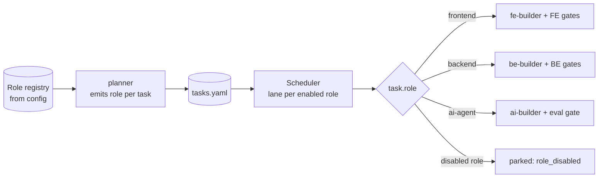
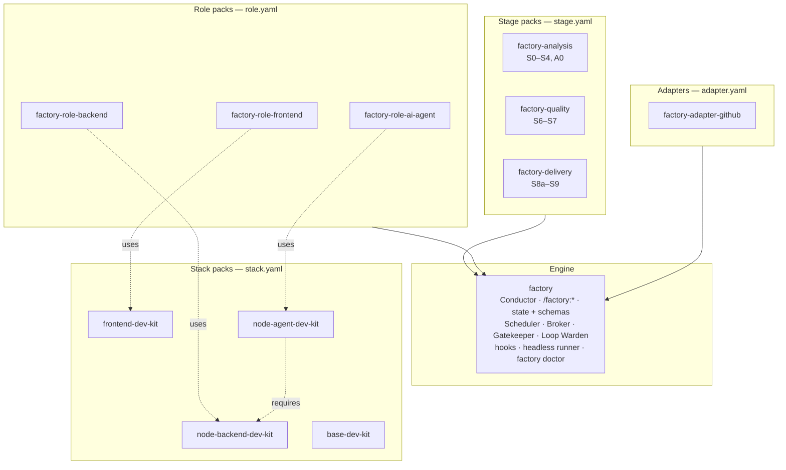

# 10 — Configuration and extensibility

Goal: **same engine, different projects** — and adding a developer role is a new plugin plus a config entry, with zero changes to the Conductor, control plane or schemas.

## `factory.config.yaml`

The single configurability surface. The pipeline order lives **only here** — agents and skills never restate it (fixes the "station order in three files" problem).

```yaml
version: 1
project:
  name: acme-portal
  repo_host: github                    # delivery adapter
  default_branch: develop

# ---- roles: which developer roles are active, and with which stack ----------
roles:
  frontend:
    enabled: true
    pack: factory-role-frontend
    stack: frontend-dev-kit
    owns_paths: ["apps/web/src/**", "apps/web/e2e/**", "apps/web/public/**"]
    boilerplate: react-fsd-starter
  backend:
    enabled: false                     # flip later; parked tasks light up
    pack: factory-role-backend
    stack: node-backend-dev-kit
    owns_paths: ["apps/api/**"]
    boilerplate: backend-boilerplate
  ai-agent:
    enabled: false
    pack: factory-role-ai-agent
    stack: node-agent-dev-kit
    owns_paths: ["apps/agents/**"]
    boilerplate: agent-boilerplate
shared_paths:
  "packages/api-types/**": { owner: contract-steward, generated_from: api-contract.yaml }

# ---- pipeline: the order of stages (one definition) ---------------------------
# Each id resolves to a stage.yaml shipped by an installed stage pack (see Packaging).
pipeline:
  profiles:
    standard: [intake, requirements, stories, prototype, architecture, planning,
               implementation, verification, qa, docs, delivery]
    patch:    [requirements-lite, implementation, verification-lite, delivery]
    full:     { extends: standard, prototype: always, qa: full_charter }
  stages:                        # project overrides of stage.yaml defaults, key by key
    prototype:    { when: prototype.trigger }
    verification: { lenses: [behaviour, assumptions, spec-adr-drift, tests, edge-cases, security, over-engineering] }

prototype:
  trigger:
    any: [new_user_facing_surface, net_new_components>=2, stakeholder_alignment==unconfirmed]
    skip_all: [variation_of_existing_pattern, points<=3]

flow:          { policy: kanban, kanban: { wip: { build.frontend: 1, verify: 2 } } }   # see 08
quality:
  coverage_changed_lines_min: 90
  axe_critical_max: 0
  review_blocking: [P0, P1]
  task_limits: { files_max: 3, loc_max: 200 }
  tdd: { mode: required, author: separate, pipeline_red: true }   # author: separate | builder_two_phase (see 15)
budgets:       { feature: { tokens: 2_500_000, wall_clock_min: 240 } }                 # see 09
context:       { budgets: { conductor: 20000, execution_roles: 45000 } }                # see 07
model_tiers:   { reasoning: opus, execution: sonnet, mechanical: haiku }
policy:
  protected_paths: [".github/**", "**/*.env*", "pnpm-lock.yaml", "infra/**"]
  commit_convention: conventional
  branch_pattern: "factory/{feature}-{slug}"
  human_owned: [new_dependency, destructive_migration, public_api_removal, gate_override, merge]
intake: { source: local, inbox: .factory/inbox }
delivery: { adapter: github, draft_pr: true, reviewers: [] }
```

Stage ids are resolved through the installed stage packs, and `role:` prefixes inside a stage (e.g. `role:auditor`, `role:gate-impl`) through the role registry, so the pipeline definition names neither agents nor roles. A stage's default agents, gate, human gate and `on_fail` come from its `stage.yaml`:

```yaml
# stage.yaml — shipped by factory-quality
id: verification
agents: [acceptance-test-author, reviewer, role:auditor]
parallel: true
inputs:  [spec, stories, api-contract, diff]          # artifact types, schema-checked
outputs: [review-findings, acceptance-report, audits]
gate: gate-verify
on_fail: goto:implementation
tracked_ids: [AC, REQ, HD]                           # IDs this stage must carry forward (see 07)
requires: { factory: "^1" }
```

Config is validated by a JSON schema in `factory`, by `factory doctor` before every run, and by `npm run validate` in this repo.

## Configuration layers

| Layer | File | Typical content |
|---|---|---|
| Factory defaults | `factory/defaults.yaml` | standard pipeline, gate set, budgets |
| Organisation | `~/.factory/org.yaml` (optional) | model tiers, protected paths, delivery adapter |
| Project | `.factory/factory.config.yaml` | roles, stacks, owns_paths, thresholds, flow policy |
| Feature override | `features/<id>/overrides.yaml` | tier, prototype force/skip, budget extension (audited) |

Later layers override earlier ones key by key; every override is logged as an event.

## Adding a role

Adding `backend` (the test of the architecture):

1. **Install** `factory-role-backend` and `node-backend-dev-kit` from the marketplace.
2. **Implement the role contract** ([05](05-agents-and-roles.md#the-role-contract)) in the pack: `role.yaml`, `be-builder`, `be-test-author`, `migration-author`, auditor scripts (OpenAPI conformance, migration dry-run), `gate-impl` / `gate-verify`, task-type skills, boilerplate pointer.
3. **Flip** `roles.backend.enabled: true` and set `owns_paths`.
4. **Nothing else.** The planner reads the role registry and starts emitting `role: backend` tasks; previously parked `role: backend` tasks become `ready`; the Scheduler adds a `build.backend` lane; the contract-steward is already the arbiter of `api-contract.yaml`.

Adding `ai-agent` follows the same steps; its role pack adds an `eval-author` and its `gate-verify` includes an eval run against a golden dataset with thresholds.

## Adding or replacing a stage

The same recipe one level up. A security scan between verification and QA:

1. **Install** a stage pack (e.g. `factory-stage-security`) whose `stage.yaml` declares `id: security-scan`, its agents or scripts, inputs, outputs and gate.
2. **Insert** `security-scan` into a profile in `factory.config.yaml`.
3. `factory doctor` checks that every input of the new stage is produced by an earlier stage and that its gate script exists. Nothing else changes.

Replacing a stage works the same way: a project can point `verification` at its own pack, for example a review with company-specific lenses, without forking `factory-quality`.

Possible later roles with the same recipe: `mobile`, `devops` (IaC + pipeline tasks, plan/apply split with human approval), `data` (migrations + dbt models), `design` (see [14](14-risks-and-open-questions.md#open-questions)).



## Reference architectures

Each stack pack carries one reference architecture: its rules describe it, its `architecture-audit` skill and conformance validator check it, and its boilerplate is the A0 Bootstrap starting point. S3 (`solution-architect`) designs features *inside* that architecture and records any deviation as an ADR.

| Role | Reference architecture | Stack pack | Boilerplate | Enforced by |
|---|---|---|---|---|
| frontend | Feature-Sliced Design, six layers `app → pages → widgets → features → entities → shared`, one public `index.ts` per slice, no same-layer imports (`docs/frontend/architecturev2`) | `frontend-dev-kit` (18 skills, 10 rules) | `react-fsd-starter` (to be extracted, see [14](14-risks-and-open-questions.md#open-questions)) | ESLint `no-restricted-imports` + dependency-cruiser; `architecture-audit` skill |
| backend | Layered `routes → controllers → services → repositories → db`, composition root, Zod at the edge, problem+json errors, keyset pagination, health/readiness, graceful shutdown | `node-backend-dev-kit` | `backend-boilerplate/` (Express 5, Drizzle, Postgres, JWT + RBAC, Docker, Testcontainers) | dependency-cruiser layer rules in `npm run lint`; `architecture-audit` skill |
| ai-agent | The same HTTP layering plus `services → agents/<name>` (LangGraph state, graph, nodes, tools) with injected models and retrievers; RAG via ingestion pipeline + hybrid retriever; Postgres checkpointer | `node-agent-dev-kit` (requires `node-backend-dev-kit`) | `agent-boilerplate/` (LangGraph.js + LangChain.js, OpenRouter, pgvector, guardrails, SSE, evals) | dependency-cruiser agent rules; eval gate |

## Stack packs

Swapping or adding a stack never touches a role pack:

| Contains | Example in `frontend-dev-kit` |
|---|---|
| Rules (≤ 40 lines, path-scoped to the role's `owns_paths`) | `fsd-boundaries`, `typescript`, `react`, `data-fetching`, `forms`, `i18n`, `a11y` |
| Golden files | one per task type: entity model, query hook, mutation hook, feature UI, widget, page, route, test |
| Scaffolding skills + scripts | `create-entity`, `create-feature`, `add-route`, `wire-navigation` (deterministic) |
| Conformance validator | FSD layer/import rules, public-API (index) rule |
| Index adapter | how to find routes, components, entities for the Cartographer |
| Boilerplate | `react-fsd-starter` template reference |

**Rule scoping fix:** today backend rules match `**/*.ts` and attach to frontend edits. In the factory, the installer writes each rule's `globs` from the role's `owns_paths`, so a rule can never load outside its role's territory.

## Packaging

Four layers plus adapters. Each layer has a different reason to change, so a typical change touches one plugin. Each unit is a plugin in this marketplace, versioned independently, and plugs in through a small manifest — the engine knows the manifests, never an agent by name.



| Layer | Plugin | Contents | Manifest | Depends on | Changes when |
|---|---|---|---|---|---|
| Engine | `factory` | Conductor, `/factory:*` commands, state and artifact schemas, Scheduler, Context Broker, Gatekeeper, Loop Warden, Cartographer, `curator` (the digest agent belongs to context management, not to a stage), hooks, headless runner (incl. track runner, see [02](02-architecture.md#no-sub-orchestrators)), `factory doctor`, `factory config explain`, always-on hot rules (from `base-dev-kit`). **No SDLC agents** | — | — | the process mechanics change (rarely) |
| Stage | `factory-analysis` | S0–S4 and A0 Discovery: intake-normaliser, codebase-analyst, requirements-analyst, story-writer, solution-architect, contract-steward, planner, test-strategist; skills: guided interview, prd-authoring, delta-spec, task-decomposition | `stage.yaml` per stage | factory | how requirements, architecture and plans are produced |
| Stage | `factory-quality` | S6–S7: acceptance-test-author, reviewer, qa-engineer; skills: seven-lens-review, qa-heuristics | `stage.yaml` | factory | review and QA policy |
| Stage | `factory-delivery` | S8a–S9: tech-writer, release-manager; PR template, provenance, comment triage | `stage.yaml` | factory + an adapter | docs and PR conventions |
| Role | `factory-role-frontend` | fe-test-author, fe-builder, fe-auditor, prototyper, task-type skills, FE gate scripts | `role.yaml` | factory, `frontend-dev-kit` | how a frontend developer works |
| Role | `factory-role-backend` (P6) | be-test-author, be-builder, migration-author, OpenAPI and migration audits | `role.yaml` | factory, `node-backend-dev-kit` | |
| Role | `factory-role-ai-agent` (P7) | ai-architect, ai-builder, rag-builder, eval-author, eval gate | `role.yaml` | factory, `node-agent-dev-kit` | |
| Stack | `frontend-dev-kit`, `node-backend-dev-kit`, `node-agent-dev-kit`, `base-dev-kit` (exist) | rules, skills, golden files, boilerplate pointer | `stack.yaml` (new, small) | `node-agent-dev-kit` → `node-backend-dev-kit` | the technology changes |
| Adapter | `factory-adapter-github`; later `-gitlab`, `-jira` | PR assembly, comment ingestion via `gh`, ticket import | `adapter.yaml` | factory | the hosting platform changes |

That is **eight new plugins**; the four stack packs exist and only gain a `stack.yaml`. Build order follows the roadmap ([13](13-roadmap.md)).

**Why the core agents leave `factory`.** The engine changes rarely; the SDLC agents change often (a new review lens, a different PRD format, another QA heuristic). Keeping them apart lets you release a better reviewer without touching gate logic or state schemas, and lets a project replace a whole stage ([Adding or replacing a stage](#adding-or-replacing-a-stage)).

### The four manifests

| Manifest | Declares | Example |
|---|---|---|
| `stage.yaml` | id, agents (or `role:` slots), parallel, inputs / outputs (artifact types), gate, human gate, `on_fail`, `tracked_ids`, engine range | [above](#factoryconfigyaml) |
| `role.yaml` | name, task types, builder / test-author / auditor agents, gate scripts, budgets, default stack | [05](05-agents-and-roles.md#the-role-contract) |
| `stack.yaml` | how to check the reference architecture, test commands, golden files per task type, index adapter, boilerplate | below |
| `adapter.yaml` | which delivery or intake operations it implements | `open_pr`, `read_comments`, `import_ticket` |

```yaml
# stack.yaml — new in node-backend-dev-kit
architecture_check: npm run lint          # ESLint + dependency-cruiser layer rules
test: { unit: npm run test:unit, integration: npm run test:integration }
golden_files:
  endpoint: skills/express-resource/examples.md
  error-mapping: skills/error-handling/SKILL.md
index_adapter: express-routes              # how the Cartographer finds routes and modules
boilerplate: { repo: dev-AI-plugins, path: backend-boilerplate, ref: backend-boilerplate-v1.0.0 }
```

### Keeping the set healthy

- **`factory doctor`** runs before every `/factory:run` and in CI. It checks that every stage, role, stack and adapter named in config is installed; every agent, skill and gate script a manifest names exists; every stage input is produced by an earlier stage's output; and every pack's `requires.factory` range matches the installed engine. It extends what `scripts/check-plugin-deps.mjs` does in this repo today.
- **`factory config explain [key]`** prints the merged config and which layer (defaults, org, project, feature) set each value.
- **Semver on contracts.** A manifest or artifact-schema change that breaks packs is a major version of `factory`; packs declare the range they support.
- **Tests per layer.** Engine: control-plane tests ([12](12-observability-and-evals.md#layer-1--control-plane-tests-no-model)). Stage packs: fixture tests ("these input artifacts → gate passes"). Role packs: at least one golden ticket each. Stack packs: their boilerplate's own CI.
- **Generated, never hand-copied:** Cursor agent copies (as `build-cursor-agents.mjs` does today) and rule `globs` (from `owns_paths`).
- **Versioned boilerplates.** A0 Bootstrap clones a boilerplate at a git tag, never at a moving branch, so a boilerplate change can't silently change new projects. Move them to template repositories once a second consumer project exists ([14](14-risks-and-open-questions.md#open-questions), Q11).

Rules for packs (fixes the copy-paste problem):

- Packs **call** core scripts (`factory gate …`, `factory envelope …`); they never vendor copies.
- A pack declares its required `factory` version range; `factory doctor` and `scripts/check-plugin-deps.mjs` verify it.
- Each pack ships its eval cases (`evals/cases/<plugin>.json`), as required by this repo's CLAUDE.md.

## Cursor best-effort profile

Claude Code is the primary harness. Cursor gets a reduced profile generated from the same sources (as `build-cursor-agents.mjs` does today):

| Capability | Claude Code | Cursor profile |
|---|---|---|
| Conductor in main session | ✅ | ✅ (agent mode + command) |
| Parallel subagents | ✅ | sequential fallback |
| Worktree isolation per track | ✅ | single-track only (role tracks run sequentially) |
| Hooks enforcement | ✅ local + CI | **CI only** — gates run as scripts the agent must call; required checks enforce on PR |
| Headless runner | ✅ `claude -p` | not supported |
| Model tiers | frontmatter | mapped ids via `model-tiers.json` |

Because every critical property is also enforced by scripts and CI, a Cursor run is slower and less isolated, but not less safe.
