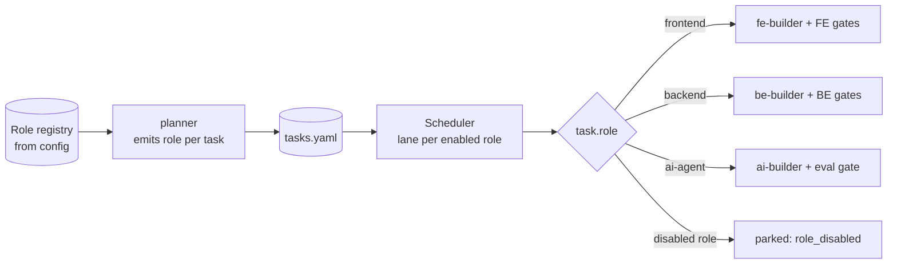

# 10 — Configuration and extensibility

Goal: **same engine, different projects** — and adding a developer role is a new plugin plus a config entry, with zero changes to the Conductor, control plane or schemas.

## `factory.config.yaml`

The single configurability surface. The pipeline order lives **only here** — agents and skills never restate it (fixes the "station order in three files" problem).

```yaml
version: 1
project:
  name: acme-portal
  repo_host: github                    # delivery adapter
  default_branch: develop

# ---- roles: which developer roles are active, and with which stack ----------
roles:
  frontend:
    enabled: true
    pack: factory-role-frontend
    stack: frontend-dev-kit
    owns_paths: ["apps/web/src/**", "apps/web/e2e/**", "apps/web/public/**"]
    boilerplate: react-fsd-starter
  backend:
    enabled: false                     # flip later; parked tasks light up
    pack: factory-role-backend
    stack: node-backend-dev-kit
    owns_paths: ["apps/api/**"]
    boilerplate: backend-boilerplate
  ai-agent:
    enabled: false
    pack: factory-role-ai-agent
    stack: node-agent-dev-kit
    owns_paths: ["apps/agents/**"]
    boilerplate: agent-boilerplate
shared_paths:
  "packages/api-types/**": { owner: contract-steward, generated_from: api-contract.yaml }

# ---- pipeline: stages, agents, gates (one definition) -------------------------
pipeline:
  profiles:
    standard:
      - { id: intake,        agents: [intake-normaliser],          gate: gate-intake }
      - { id: requirements,  agents: [requirements-analyst],       gate: gate-spec,   human: GATE-A }
      - { id: stories,       agents: [story-writer],               gate: gate-stories }
      - { id: prototype,     agents: [role:prototyper],            gate: gate-proto,  human: GATE-P, when: prototype.trigger }
      - { id: architecture,  agents: [solution-architect, contract-steward], gate: gate-arch }
      - { id: planning,      agents: [planner, test-strategist],   gate: gate-plan,   human: GATE-B }
      - { id: implementation, mode: task_loop, route_by: task.role, gate: role:gate-impl }
      - { id: verification,  agents: [acceptance-test-author, reviewer, role:auditor], parallel: true,
          gate: gate-verify, on_fail: goto:implementation }
      - { id: qa,            agents: [qa-engineer],                gate: gate-qa,     on_fail: goto:implementation }
      - { id: delivery,      agents: [release-manager],            gate: gate-ready-for-pr, human: GATE-C }
    patch:    [requirements-lite, implementation, verification-lite, delivery]
    full:     { extends: standard, prototype: always, qa: full_charter }

prototype:
  trigger:
    any: [new_user_facing_surface, net_new_components>=2, stakeholder_alignment==unconfirmed]
    skip_all: [variation_of_existing_pattern, points<=3]

flow:          { policy: kanban, kanban: { wip: { build.frontend: 1, verify: 2 } } }   # see 08
quality:
  coverage_changed_lines_min: 90
  axe_critical_max: 0
  review_blocking: [P0, P1]
  task_limits: { files_max: 3, loc_max: 200 }
  tdd: { mode: required, author: separate, pipeline_red: true }   # author: separate | builder_two_phase (see 15)
budgets:       { feature: { tokens: 2_500_000, wall_clock_min: 240 } }                 # see 09
context:       { budgets: { conductor: 20000, execution_roles: 45000 } }                # see 07
model_tiers:   { reasoning: opus, execution: sonnet, mechanical: haiku }
policy:
  protected_paths: [".github/**", "**/*.env*", "pnpm-lock.yaml", "infra/**"]
  commit_convention: conventional
  branch_pattern: "factory/{feature}-{slug}"
  human_owned: [new_dependency, destructive_migration, public_api_removal, gate_override, merge]
intake: { source: local, inbox: .factory/inbox }
delivery: { adapter: github, draft_pr: true, reviewers: [] }
```

`role:` prefixes (e.g. `role:auditor`, `role:gate-impl`) are resolved through the role registry, so the pipeline definition stays role-agnostic.

Config is validated by a JSON schema in `factory-core` and by `npm run validate` in this repo.

## Configuration layers

| Layer | File | Typical content |
|---|---|---|
| Factory defaults | `factory-core/defaults.yaml` | standard pipeline, gate set, budgets |
| Organisation | `~/.factory/org.yaml` (optional) | model tiers, protected paths, delivery adapter |
| Project | `.factory/factory.config.yaml` | roles, stacks, owns_paths, thresholds, flow policy |
| Feature override | `features/<id>/overrides.yaml` | tier, prototype force/skip, budget extension (audited) |

Later layers override earlier ones key by key; every override is logged as an event.

## Adding a role

Adding `backend` (the test of the architecture):

1. **Install** `factory-role-backend` and `node-backend-dev-kit` from the marketplace.
2. **Implement the role contract** ([05](05-agents-and-roles.md#the-role-contract)) in the pack: `role.yaml`, `be-builder`, `be-test-author`, `migration-author`, auditor scripts (OpenAPI conformance, migration dry-run), `gate-impl` / `gate-verify`, task-type skills, boilerplate pointer.
3. **Flip** `roles.backend.enabled: true` and set `owns_paths`.
4. **Nothing else.** The planner reads the role registry and starts emitting `role: backend` tasks; previously parked `role: backend` tasks become `ready`; the Scheduler adds a `build.backend` lane; the contract-steward is already the arbiter of `api-contract.yaml`.

Adding `ai-agent` follows the same steps; its role pack adds an `eval-author` and its `gate-verify` includes an eval run against a golden dataset with thresholds.

Possible later roles with the same recipe: `mobile`, `devops` (IaC + pipeline tasks, plan/apply split with human approval), `data` (migrations + dbt models), `design` (see [14](14-risks-and-open-questions.md#open-questions)).



## Reference architectures

Each stack pack carries one reference architecture: its rules describe it, its `architecture-audit` skill and conformance validator check it, and its boilerplate is the A0 Bootstrap starting point. S3 (`solution-architect`) designs features *inside* that architecture and records any deviation as an ADR.

| Role | Reference architecture | Stack pack | Boilerplate | Enforced by |
|---|---|---|---|---|
| frontend | Feature-Sliced Design, six layers `app → pages → widgets → features → entities → shared`, one public `index.ts` per slice, no same-layer imports (`docs/frontend/architecturev2`) | `frontend-dev-kit` (18 skills, 10 rules) | `react-fsd-starter` (to be extracted, see [14](14-risks-and-open-questions.md#open-questions)) | ESLint `no-restricted-imports` + dependency-cruiser; `architecture-audit` skill |
| backend | Layered `routes → controllers → services → repositories → db`, composition root, Zod at the edge, problem+json errors, keyset pagination, health/readiness, graceful shutdown | `node-backend-dev-kit` | `backend-boilerplate/` (Express 5, Drizzle, Postgres, JWT + RBAC, Docker, Testcontainers) | dependency-cruiser layer rules in `npm run lint`; `architecture-audit` skill |
| ai-agent | The same HTTP layering plus `services → agents/<name>` (LangGraph state, graph, nodes, tools) with injected models and retrievers; RAG via ingestion pipeline + hybrid retriever; Postgres checkpointer | `node-agent-dev-kit` (requires `node-backend-dev-kit`) | `agent-boilerplate/` (LangGraph.js + LangChain.js, OpenRouter, pgvector, guardrails, SSE, evals) | dependency-cruiser agent rules; eval gate |

## Stack packs

Swapping or adding a stack never touches a role pack:

| Contains | Example in `frontend-dev-kit` |
|---|---|
| Rules (≤ 40 lines, path-scoped to the role's `owns_paths`) | `fsd-boundaries`, `typescript`, `react`, `data-fetching`, `forms`, `i18n`, `a11y` |
| Golden files | one per task type: entity model, query hook, mutation hook, feature UI, widget, page, route, test |
| Scaffolding skills + scripts | `create-entity`, `create-feature`, `add-route`, `wire-navigation` (deterministic) |
| Conformance validator | FSD layer/import rules, public-API (index) rule |
| Index adapter | how to find routes, components, entities for the Cartographer |
| Boilerplate | `react-fsd-starter` template reference |

**Rule scoping fix:** today backend rules match `**/*.ts` and attach to frontend edits. In the factory, the installer writes each rule's `globs` from the role's `owns_paths`, so a rule can never load outside its role's territory.

## Packaging

Each unit is a plugin in this marketplace, versioned independently:

| Plugin | Contents | Depends on |
|---|---|---|
| `factory-core` | `/factory:*` commands, Conductor, control-plane scripts, core agents, core skills (prd-authoring, delta-spec, task-decomposition, seven-lens-review, qa-heuristics), schemas, hooks, headless runner | — |
| `factory-role-frontend` | role contract implementation for frontend | factory-core |
| `frontend-dev-kit` | frontend stack knowledge (React FSD) | — |
| `node-backend-dev-kit` | backend stack knowledge + `backend-boilerplate` | — |
| `node-agent-dev-kit` | AI-agent stack knowledge + `agent-boilerplate` | `node-backend-dev-kit` |
| `factory-adapter-github` | PR assembly, comment ingestion via `gh` | factory-core |
| later: `factory-role-backend`, `factory-role-ai-agent`, `factory-adapter-jira`, `factory-adapter-gitlab` | | |

Rules for packs (fixes the copy-paste problem):

- Packs **call** core scripts (`factory gate …`, `factory envelope …`); they never vendor copies.
- A pack declares its required `factory-core` version range; `scripts/check-plugin-deps.mjs` (already in this repo) verifies it.
- Each pack ships its eval cases (`evals/cases/<plugin>.json`), as required by this repo's CLAUDE.md.

## Cursor best-effort profile

Claude Code is the primary harness. Cursor gets a reduced profile generated from the same sources (as `build-cursor-agents.mjs` does today):

| Capability | Claude Code | Cursor profile |
|---|---|---|
| Conductor in main session | ✅ | ✅ (agent mode + command) |
| Parallel subagents | ✅ | sequential fallback |
| Worktree isolation per track | ✅ | single-track only (role tracks run sequentially) |
| Hooks enforcement | ✅ local + CI | **CI only** — gates run as scripts the agent must call; required checks enforce on PR |
| Headless runner | ✅ `claude -p` | not supported |
| Model tiers | frontmatter | mapped ids via `model-tiers.json` |

Because every critical property is also enforced by scripts and CI, a Cursor run is slower and less isolated, but not less safe.
