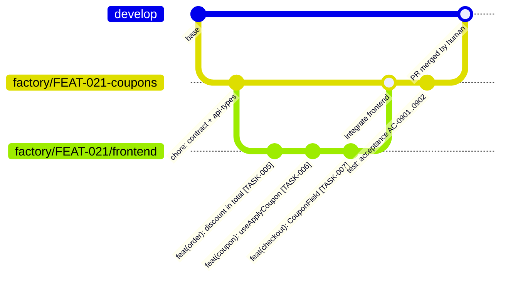
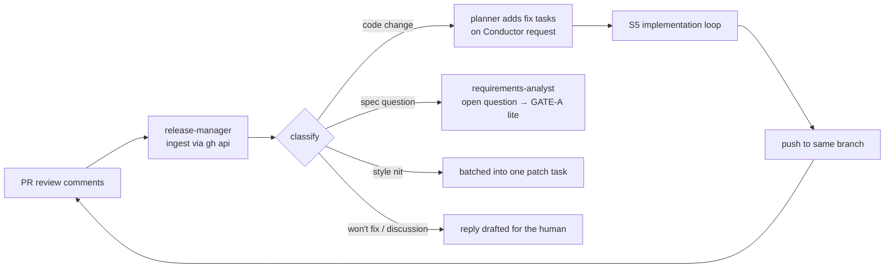

# 11 — Delivery and feedback (branches, commits, PR)

Delivery is mostly **scripts**: git and `gh` operations are deterministic and should never cost reasoning tokens. The `release-manager` agent (haiku) only writes the human-readable parts.

## Branch model



| Branch | Created by | Purpose |
|---|---|---|
| `factory/<feature>-<slug>` | script at GATE-B | feature integration branch; one PR |
| `factory/<feature>/<role>` | script per enabled role track | worktree branch for that role ([08](08-parallelism-and-flow.md#parallel-role-tracks)) |
| stacked parent | optional, `allow_stacked: true` | feature N+1 may branch from feature N's branch until N merges (kept from app-dev-kit) |

## Commits

- **One commit per task** (squash of its attempts), conventional format, with trailers:

```
feat(checkout): add CouponField to CheckoutSummary

Implements inline coupon entry with validation feedback.

Factory-Task: TASK-007
Factory-ACs: AC-0901, AC-0902
Factory-Feature: FEAT-021
```

- Commits are created by a script after `gate-impl` passes — not by the builder — so history is uniform and every commit is traceable.
- `.factory/features/<id>/` artifacts are committed alongside (spec, plan, review, QA report), so the PR carries its own evidence.
- The app's own docs from S8a (`docs/features/<FEAT>.md`, promoted ADRs, CHANGELOG, OpenAPI) land in a separate `docs(...)` commit in the same PR.
- No agent ever pushes with `--force`; the human-owned boundary covers merge.

## PR assembly (S8)

1. `gate-ready-for-pr` passes (commitlint, trailers, CI green locally).
2. Script pushes the feature branch and opens a **draft PR** with `gh pr create`.
3. PR body is assembled from templates + artifacts; the `release-manager` writes only the summary and risk notes.

```markdown
## Summary
Coupon codes at checkout (FEAT-021, change request on FEAT-012@v1).

## Spec trace
| AC | Test | Status |
|----|------|--------|
| AC-0901 apply valid coupon | TEST-0441 (acceptance), CouponField.test.tsx | ✅ |
| AC-0902 expired coupon     | TEST-0442 (acceptance)                       | ✅ |

## Delta
- ADDED: REQ-0412 coupon entry
- MODIFIED: REQ-0133 order total includes discount
- REMOVED: none (confirmed at GATE-A)

## Docs
- docs/features/FEAT-021-coupons.md (new) · CHANGELOG.md · openapi.json regenerated

## Verification
- Machine gates: tsc ✅ lint ✅ unit ✅ build ✅ a11y (0 critical) ✅
- Review: 0 P0/P1 · 2 P2 fixed · 1 P3 listed below
- QA-H: 0 S1/S2 · 1 S4 deferred (ledger DEF-118)

## Needs human attention
- Security-sensitive path touched: none
- Parked backend work: TASK-009 PUT /carts/{cartId}/coupon (role disabled)

## Provenance
Factory run FEAT-021 · 34 dispatches · 1.7M tokens · 105 min agent time · models opus/sonnet/haiku
Artifacts: .factory/features/FEAT-021/
```

The **provenance block** lets a reviewer — or the engineer on the next shift — understand what the agents did without replaying the session.

4. The Conductor sets `awaiting_human: GATE-C`. The human reviews the PR in GitHub.

## Feedback loop (S9)



- Comments are **untrusted input**: they are classified and turned into tasks or questions; they are never executed as instructions.
- Each review round counts against `backward_edges.review_rounds_max` (default 2); beyond that the feature is handed to a human.
- Replies on the PR are drafted for the human to post, unless the config explicitly allows the factory to reply.

## After merge

1. Ledger entry appended (`feature-ledger.yaml`: feature, version, PR, tests, ACs, delta).
2. Cartographer re-indexes at the merge SHA; duplication diff reported if new near-duplicates appear.
3. `current.json` and the increment record updated.
4. Parked tasks for disabled roles remain visible in `/factory:status`.
5. Feature worktrees and track branches are removed by script.
