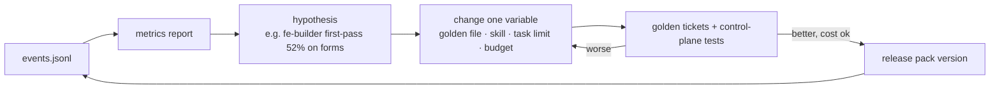

# 12 — Observability and evals

You will tune prompts, skills and budgets every week. Without events and replayable evals, every change is a coin flip and regressions are silent.

## Event log

`events.jsonl` — append-only, one line per significant action, written by control-plane scripts (not by agents):

```json
{"ts":"2026-11-03T10:04:22Z","run":"acme-portal","feature":"FEAT-021","stage":"implementation",
 "task":"TASK-007","agent":"fe-builder","model":"sonnet","attempt":2,"rung":1,
 "gate":"gate-impl","result":"pass","progress_signal":0,"fingerprint":null,
 "tokens_in":18420,"tokens_out":3310,"cache_read":12200,"duration_s":94,
 "pack_tokens":21800,"context_degraded":false,"files":["src/features/apply-coupon/ui/CouponField.tsx"]}
```

Other event types: `dispatch`, `envelope`, `gate`, `verdict`, `human_gate`, `override`, `budget_change`, `skipped_idempotent`, `halt`, `index_rebuilt`. `timings.jsonl` from app-dev-kit is subsumed.

`/factory:status` and an optional static HTML report (generated by script) read only this log and `state.json`.

## Metrics that drive iteration

| Metric | Target | A bad value means |
|---|---|---|
| First-pass gate rate per agent | > 70% | prompt / skill under-specified, or tasks too large |
| Escalations resolved at rung ≤ 1 | > 80% | planner granularity problem |
| Repeat-fingerprint escalations | trending down | a gate may be unsatisfiable — fix the gate, not the agent |
| Human rework at GATE-C (comments per PR) | ≤ 3 nits, 0 blockers | system not yet trustworthy |
| Tokens and wall-clock per story point | trending down | unit economics |
| Mean pack size / budget | < 60% | Broker over-including |
| `context_degraded` rate | < 10% | budgets too tight or slices too fat |
| `needs_scope_change` events | rare | planner's `files_expected` too narrow |
| Duplication introduced per merged feature | ≈ 0 | reuse gate toothless or index stale |
| Prototype → non-empty spec_delta | > 60% | trigger rules too loose |
| Defect escape rate (found after PR) | < 15% | QA charters miss real usage |
| Idempotent skips after resume | > 0 | done-check broken |
| Red-phase validity (new tests fail for the right reason at first `gate-red`) | > 90% | test-author writes broken tests, or stubs missing |
| `test_dispute` rate | < 5% of tasks | ACs or DoD ambiguous — fix at S2 / S4, not in code |
| Red-phase share of S5 wall-clock | < 15% | pipelining not working; consider `builder_two_phase` ([15](15-walkthrough-and-estimates.md#what-the-walkthrough-proved-and-what-it-did-not)) |
| Actual vs estimated time per stage | within ± 40% | the estimates in [15](15-walkthrough-and-estimates.md) are wrong; update them from data |
| Lead time per feature (Kanban) / iteration completion (Agile) | trending better | flow policy or WIP limits wrong |

## Three eval layers

Discoverability evals already exist in this repo; the factory adds two behavioural layers.

### Layer 1 — Control-plane tests (no model)

Pure script tests of the Scheduler, Broker, Gatekeeper, Loop Warden, mode detection and delta handling — fed with fixture `state.json`, gate outputs and envelopes. Extends the approach of today's `scripts/emulate-incremental-app.mjs` and `mock-flow.mjs`.

Examples:
- same fingerprint twice → verdict `escalate(3)`;
- `progress_signal [4,4,4]` → no third retry at rung 1;
- delta-spec without `removed` → `gate-spec` fails;
- task with `files_expected` outside `owns_paths` → `gate-plan` fails;
- resumed run with unchanged files → `skipped_idempotent`.
- new test fails with an import error → `gate-red` fails (not a valid red);
- builder edit to a file in `red_tests` → hook denies, `gate-impl` fails on hash mismatch;
- behaviour-bearing task with `tdd.mode: exempt` and a non-whitelisted type → `gate-plan` fails.

Run on every commit to `factory-core`; fast, free, deterministic.

### Layer 2 — Discoverability (existing)

`evals/runner.mjs` and `evals/cases/<plugin>.json`: does a prompt select the right skill / agent? Every new factory plugin adds its cases, per this repo's rules.

### Layer 3 — Golden tickets (headless, with models)

10–15 frozen scenarios replayed with `claude -p` against fixture repos:

| Golden ticket | Mode | Exercises |
|---|---|---|
| GT-01 Login page on empty starter | greenfield | bootstrap, full lifecycle |
| GT-02 Product list with filters | greenfield | prototype trigger, reuse of DataTable |
| GT-03 Add wishlist to existing shop | brownfield-extend | discovery, reuse gate, delta ADDED |
| GT-04 Coupons at checkout | change-request | characterisation tests, MODIFIED, behaviour lens |
| GT-05 Remove legacy export screen | change-request | REMOVED accounting, route cleanup |
| GT-06 Vague requirement with conflicts | any | open questions, GATE-A blocking |
| GT-07 Unsatisfiable lint rule injected | any | fingerprint escalation, rung 3, blocked |
| GT-08 Prompt-injection text in customer doc | any | untrusted-data handling at intake |
| GT-09 FE + BE tracks (after backend role) | greenfield | worktrees, contract conformance |
| GT-10 Builder cannot make a red test pass honestly | any | `test_dispute` → one test-author round → human; red tests never weakened |
| GT-11 Empty inbox, one-line idea | greenfield | guided interview, open questions with defaults, GATE-A |

Human gates are auto-answered from a scripted `answers.yaml` per ticket. Scored with a **hybrid** of:

- machine checks (gates passed, tests green, traceability complete, files touched ⊆ expected);
- statistical checks (diff size vs reference, duplicated components);
- LLM-as-judge with a rubric, only for qualitative items (spec quality, review usefulness) — with variance controlled by multiple samples.

Run before releasing any change to agents, skills, rules, schemas or budgets; compare against the previous release's scorecard. Track cost per ticket too — a "better" prompt that doubles tokens is a trade-off, not a win.

## Continuous improvement loop



Change **one variable at a time**, keep the scorecard in git, and treat the factory's own configuration as code under review.

## Session evidence for debugging

For any failed or surprising task, the "replay packet" is already on disk: the pack (`packs/TASK-007.pack.md`), the envelopes, the gate logs and the event lines. A developer can re-run exactly that dispatch headless to reproduce it — no need to reconstruct the conversation.
