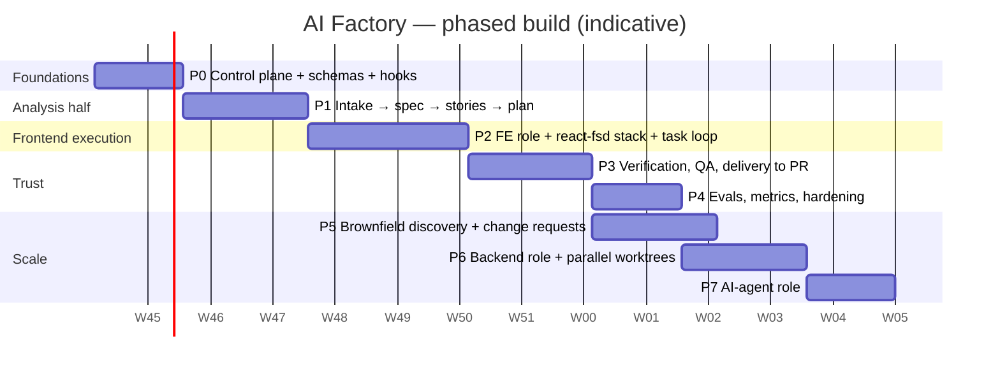

# 13 — Roadmap

Build the brakes before the engine: the control plane first, then the analysis half (most value, least risk), then frontend execution, then the parts that make it trustworthy, then brownfield and new roles.

## Phases

| Phase | Deliverables | Success criterion (exit) |
|---|---|---|
| **P0 Foundations** | `factory-core` engine (no SDLC agents); `.factory/` layout; schemas (state, envelope, spec, delta-spec, tasks, pack, human notes) and the four manifest schemas (`stage.yaml`, `role.yaml`, `stack.yaml`, `adapter.yaml`); Gatekeeper + Loop Warden + Scheduler scripts; ID-coverage checker; `factory doctor`, `factory config explain`; protected-path / owns_paths / envelope / `SessionStart` (incl. after compaction) hooks; control-plane test suite | A hand-written spec passes `gate-spec`; Layer-1 tests green; a protected-path write is actually blocked; `factory doctor` rejects a config naming a missing stage |
| **P1 Analysis half** | `factory-analysis` stage pack: intake-normaliser, requirements-analyst, story-writer, solution-architect, contract-steward, planner, test-strategist; `/factory:intake`, `next`, `run`, `status`, `gate`, `note`; GATE-A and GATE-B | From a messy customer folder → approved spec, stories, contract and `tasks.yaml` with full traceability in < 45 min |
| **P2 Frontend execution** | `factory-role-frontend` (fe-builder, fe-test-author, fe-auditor); `frontend-dev-kit` as the stack pack (slim rules, golden files, scaffold scripts, `stack.yaml`); Context Broker + packs; red → green task loop (`gate-red`, red-test hooks, pipelined red phase) with escalation ladder; Cartographer v1 (greenfield index) | A 5-task feature implemented end-to-end with green machine gates and ≤ 1 human intervention, < 90 min |
| **P3 Verification & delivery** | `factory-quality` (acceptance-test-author, reviewer with 7 parallel lenses, qa-engineer + heuristics skill), `factory-delivery` (tech-writer, release-manager), `factory-adapter-github`, PR template + provenance, S9 feedback loop, CI required checks | An auto-generated PR that a senior dev approves with only nit comments |
| **P4 Hardening** | golden tickets GT-01…08, 10–12 (GT-12 checks that a late constraint survives every hand-off); replace the estimates in [15](15-walkthrough-and-estimates.md) with measurements; metrics report; budget tuning; curator digests; headless runner | First-pass gate rate > 70%; golden tickets green; overnight headless run of 3 features without babysitting |
| **P5 Brownfield** | Discovery stage (codebase-analyst, conformance validator, baseline ledger); delta-spec flow; characterisation-test tasks; behaviour-preservation lens mandatory | GT-03…05 green; extending an existing app adds a feature with zero rewritten unrelated files and zero duplicated components |
| **P6 Backend role** | `factory-role-backend` on top of the existing `node-backend-dev-kit` (+ `stack.yaml`) and `backend-boilerplate`, worktree tracks driven by the track runner, integration merge order, contract conformance gate | A full-stack feature delivered with FE and BE built in parallel; **zero changes** to `factory-core` code |
| **P7 AI-agent role** | `factory-role-ai-agent` on top of the existing `node-agent-dev-kit` (+ `stack.yaml`) and `agent-boilerplate`, eval gate | An agent feature delivered with an eval suite meeting its thresholds; zero `factory-core` changes |

**Use P1 for real work before starting P2.** Analysis artifacts are where the factory creates the most value with the least risk — even a human implementing from a factory-produced plan benefits.

## Mapping from today's kits

| Today | Becomes |
|---|---|
| `spec-dev-kit` scripts (intake, validate, publish, changes, increments) | ideas and some code ported into `factory-core` P0–P1 (schemas, delta, increments) |
| `spec-dev-kit` agents (7) | the `factory-analysis` stage pack: `requirements-analyst` + skills (interrogation, enrichment) |
| `html-generator-kit` | the optional prototype stage inside `factory-role-frontend` (same stack, sandboxed) |
| `feature-dev-kit` (13 agents) | `fe-builder` + `fe-test-author` + `fe-auditor` + task-type skills; scaffold scripts move to `frontend-dev-kit` |
| `frontend-orchestrator-kit`, `app-orchestrator-kit` | the single Conductor + Scheduler; parallel role tracks use the track runner, not a nested orchestrator |
| `frontend-dev-kit` | the frontend stack pack (rules slimmed to ≤ 40 lines, path-scoped); `docs/frontend/architecturev2` stays its reference architecture |
| `backend-dev-kit`, `agent-dev-kit` (app-dev-kit) | superseded as stack packs by `node-backend-dev-kit` and `node-agent-dev-kit` (top level, with verified boilerplates); their agents are starting material for the P6 / P7 role packs |
| `base-dev-kit` | always-on hot rules (honesty, security) in `factory-core` |

The old kits stay installable until P4 is done; they are then deprecated in the marketplace.

## First two weeks, concretely

1. Write the core schemas and the four manifest schemas, and validate them against two hand-made example features (one greenfield, one change request).
2. Implement Gatekeeper and Loop Warden with fixture tests — fingerprint, progress signal, ladder, budgets.
3. Implement `/factory:next` as a thin command that only reads state, calls scripts and prints what it *would* dispatch (dry-run mode).
4. Add the three hooks that matter most: protected paths, role `owns_paths`, envelope validation.
5. Wire the first real spoke (`requirements-analyst`) and run GT-06 (vague requirement) end-to-end.
