# 15 — Walkthrough and time / cost estimates

A paper run (desk-check) of one real-life task through every stage. It shows what each agent reads and writes, where the human is involved, and how long and how many tokens each step should take. Then a revision pass removes the bottlenecks the walkthrough exposed.

> **Status of these numbers: estimates, not measurements.** Nothing has been built yet. Each figure comes from the assumptions listed below and from the one measured app-dev-kit run. The golden tickets in P4 ([13](13-roadmap.md)) replace every figure here with a measured one ([12](12-observability-and-evals.md#metrics-that-drive-iteration)).

## Assumptions

| Assumption | Value used | Basis |
|---|---|---|
| Machine gates for touched scope (tsc, lint, unit, build) | 2 min per run | app-dev-kit measured a *full* sweep at ~35 s; 2 min leaves room for test start-up and the browser |
| Sonnet builder dispatch, one task of ≤ 3 files / ≤ 200 LOC | 5–9 min | size limits from [10](10-configuration-and-extensibility.md) |
| Test-author red phase | 3–5 min | smaller pack and output than the builder's |
| First-pass gate rate | 80% (one rung-1 retry per five tasks) | P4 target is > 70% ([13](13-roadmap.md)) |
| Conductor turn | ~20 s and ~15k input tokens, mostly cached | reads state, envelopes and verdicts only ([07](07-context-engineering.md)) |
| Human gate latency | **not counted** in agent time | it depends on you, not on the factory |
| Uncertainty | ± 40% on every total | no measurements yet |

## Scenario A — change request "Coupons at checkout" (golden ticket GT-04)

**Starting state.** The app was built by the factory earlier, so the feature ledger has `FEAT-012 checkout@v1` and the capability index is fresh at `HEAD`. Only the frontend role is enabled. The customer sends a short email: *"Customers should be able to enter a coupon code at checkout. Expired codes must show a clear message."*

**What the factory decides:**

- **Mode:** change request. The request mentions the checkout screen, which the ledger knows.
- **Tier:** standard (5 frontend tasks).
- **Prototype:** skipped by trigger rule. The change is a variation of an existing pattern (an input with an inline error) and adds only 1 net-new component. The skip is logged, not silent.

### Step by step (before optimisation)

| # | Stage | Who | Reads → writes | Gate | Agent min | Tokens (k) |
|---|---|---|---|---|---|---|
| 1 | S0 Intake | `intake-normaliser` (haiku) + script | email → `normalised/SRC-031.md`, source IDs | `gate-intake` | 2 | 25 |
| 2 | A0 Discovery | Context Broker (script) | index is fresh → only composes the `checkout` slice | — | 1 | 0 |
| 3 | S1 Requirements | `requirements-analyst` (opus) | slice, ledger `FEAT-012` → `delta-spec.md` (ADDED REQ-0412, MODIFIED REQ-0133, REMOVED none), 2 open questions with defaults (stackable coupons? → no) | `gate-spec` | 8 | 110 |
| — | **GATE-A** | **you** | approve delta-spec, answer 2 questions | | — | — |
| 4 | S2 Stories | `story-writer` (sonnet) | delta-spec → `stories.yaml` (2 stories, 2 Gherkin ACs), `ux-notes.md` (empty, loading, invalid, expired states) | `gate-stories` | 5 | 55 |
| 5 | S3 Architecture ∥ Contract | `solution-architect` (opus) ∥ `contract-steward` (sonnet) | stories, inventory → `component-map.md` (reuse `shared/ui/Input`, `InlineError`), `api-contract.yaml` op `applyCoupon` + mock | `gate-arch` | 6 | 120 |
| 6 | S4 Planning ∥ Test plan | `planner` (opus) ∥ `test-strategist` (sonnet) | all above → `tasks.yaml` (TASK-004…008 frontend, TASK-009 backend **parked**), `test-plan.md` | `gate-plan` | 6 | 140 |
| — | **GATE-B** | **you** | approve plan | | — | — |
| 7 | S5 Acceptance (outer red) | `acceptance-test-author` | spec + contract only → 2 failing acceptance tests | — | 8 *(off critical path)* | 60 |
| 8 | S5 TASK-004 characterisation | `fe-test-author` | current `order/model/total.ts` → tests that pin today's totals and rounding; must **pass** | `gate-impl` | 5 | 40 |
| 9 | S5 TASK-005 discount in total | red: `fe-test-author` · green: `fe-builder` | DoD, AC-0901 → red tests + stub → implementation | `gate-red`, `gate-impl` | 4 + 7 + 2 = 13 | 95 |
| 10 | S5 TASK-006 `useApplyCoupon` | red + green | contract mock → hook tests → hook | `gate-red`, `gate-impl` | 13 | 95 |
| 11 | S5 TASK-007 `CouponField` | red + green, **1 retry** (a11y lint rule, fixed at rung 1) | golden file `feature-ui` → component tests → component | `gate-red`, `gate-impl` ×2 | 5 + 9 + 2 + 5 = 21 | 155 |
| 12 | S5 TASK-008 wire into `CheckoutSummary` | red + green | widget test "total shows discount" → composition + i18n keys | `gate-red`, `gate-impl` | 3 + 5 + 2 = 10 | 75 |
| 13 | S6 Verification | machine gates + acceptance run; 7 review lenses in parallel (opus, cached prefix) + merge (haiku); `fe-auditor`; 1 P2 fix | diff, spec, ADRs → `review.md`, audits | `gate-verify` | 4 + 7 + 5 = 16 | 310 |
| 14 | S7 QA (standard charter) | `qa-engineer` (black-box, Playwright) | running build, stories → `qa-report.md`, 1 S4 defect deferred | `gate-qa` | 20 | 140 |
| 14a | S8a Docs | `tech-writer` (haiku) + OpenAPI script | feature artifacts, diff → `docs/features/FEAT-021-coupons.md`, CHANGELOG entry | `gate-docs` | 3 | 30 |
| 15 | S8 Delivery | script + `release-manager` (haiku) | feature folder → 5 commits with trailers, draft PR | `gate-ready-for-pr` | 3 | 20 |
| — | **GATE-C** | **you** | review the PR in GitHub | | — | — |
| ∑ | Curator digests (5) | `curator` (haiku) | stage exits → `digest.md` | schema | async | 50 |
| ∑ | Conductor | main session | ~40 turns | — | 13 | 600 |
| | **Total** | | **36 dispatches** | | **≈ 145 min** | **≈ 2.1M** |

S5 is the critical path: 62 of the 145 minutes. That is where the revision pass looks first.

### Revision pass — bottlenecks found and fixes applied

| # | Bottleneck found | Fix (now part of the design) | Saves |
|---|---|---|---|
| O1 | The extra test-author dispatch per task sits on the critical path. app-dev-kit hit the same problem: three sequential test spawns took ~40 min | **Red-phase pipelining**: while the builder works on task N, the test-author writes red tests for the next ready task. Test files are disjoint and `gate-impl` runs only the current task's tests ([03](03-sdlc-pipeline.md#test-first-two-nested-loops)) | 12 min |
| O2 | TASK-005 and TASK-006 are independent but run one after another in a single build lane | Allow 2 parallel tasks **inside one feature** when DAG-independent tasks have disjoint `files_expected` (one worktree each, off the feature branch): `flow.parallel_tasks_per_role.frontend: 2` ([08](08-parallelism-and-flow.md#flow-policies)) | 9 min |
| O3 | QA waits for the whole review and fix cycle to finish | QA starts after S6's machine gates, in parallel with the review lenses; only the charters touched by a later fix are re-run ([03](03-sdlc-pipeline.md#the-implementation-loop-s5--s6-in-detail)) | 9 min |
| O4 | The Conductor is ~30% of all tokens: it re-reads the full `state.json` each turn | `factory state --brief` (≤ 3k tokens) instead of the full file, and independent dispatches batched into one turn (~40 → ~25 turns) ([07](07-context-engineering.md#the-conductors-own-context)) | 5 min, 350k tokens |
| O5 | TASK-008's wiring and i18n keys are boilerplate | The stack pack's wiring script does them; the builder writes only the behaviour | 2 min, 15k tokens |
| O6 | Five digests, but only three are read downstream | Curator runs only at S1, S4 and S6 exits | 20k tokens |
| O7 | Docs wait for QA although they need only the final diff | `tech-writer` runs in parallel with the QA charter, after the review fix | 3 min |

### Optimised timeline

```mermaid
gantt
    title FEAT-021 coupons, optimised agent timeline (estimate, human gates excluded)
    dateFormat HH:mm
    axisFormat %H:%M
    section Analysis
    S0 intake                 :s0, 00:00, 2m
    A0 slice                  :a0, after s0, 1m
    S1 delta-spec             :s1, after a0, 8m
    GATE-A                    :milestone, ga, after s1, 0m
    S2 stories                :s2, after ga, 5m
    section Design
    S3 arch and contract      :s3, after s2, 6m
    S4 plan and test plan     :s4, after s3, 6m
    GATE-B                    :milestone, gb, after s4, 0m
    section Build lane 1
    Acceptance tests red      :acc, after gb, 8m
    T004 characterisation     :t4, after gb, 5m
    T005 red and green        :t5, after t4, 13m
    T007 green with 1 retry   :t7, after t5, 16m
    T008 green, script wiring :t8, after t7, 5m
    section Build lane 2
    T006 red, pipelined       :t6r, after gb, 4m
    T006 green                :t6, after t4, 9m
    section Verify
    Machine gates             :mg, after t8, 4m
    Review lenses and fix     :rv, after mg, 12m
    QA charter                :qa, after mg, 20m
    Docs, tech-writer         :doc, after rv, 3m
    QA re-run touched charter :qr, after qa, 3m
    section Deliver
    S8 PR                     :pr, after qr, 3m
    GATE-C                    :milestone, gc, after pr, 0m
```

Conductor turns (~8 min in total) are spread between these bars and are not drawn.

### Totals for Scenario A

| | Before revision | After revision | Target ([00](00-lessons-from-app-dev-kit.md#measured-baseline-to-beat)) | app-dev-kit today |
|---|---|---|---|---|
| Analysis half (S0–S2 + Conductor share) | 18 min | 18 min | < 45 min | up to 3 h (spec run) |
| Build half (S3–S8 + Conductor share) | 127 min | **87 min** | < 90 min | ~4 h 40 m (`feature-dev` only) |
| **Agent time, intake to PR** | **≈ 2 h 25 m** | **≈ 1 h 45 m** (range 1 h 05 m – 2 h 30 m) | | ~7 h + |
| Tokens | ≈ 2.1M | **≈ 1.7M** (opus ~0.8M incl. Conductor, sonnet ~0.8M, haiku ~0.1M) | budget 2.5M | not recorded |
| Dispatches | 36 | 34 | budget 60 | |
| Human touch points | GATE-A, GATE-B, GATE-C | same | | |

**Elapsed time** = agent time + your response time at three gates. Run interactively with prompt answers, the feature is a PR in about 2 hours. Run headless overnight, it waits at GATE-A until you answer, then at GATE-B.

For money: multiply the token split by the current per-model price list, and remember that most input tokens are cache reads (prefix ordering, [07](07-context-engineering.md#prompt-cache-friendly-ordering)). Prices are deliberately not hard-coded here because they change.

## Scenario B — patch "Rename the checkout button and use the brand colour token"

| Stage | Agent min | Tokens (k) |
|---|---|---|
| S0 intake (`--text`) + S1-lite delta note | 3 | 30 |
| S5 one task, `tdd: exempt` (copy/style), builder + gate | 5 | 50 |
| S6-lite: machine gates + lenses 1 and 6 | 3 | 50 |
| S8 PR + Conductor | 3 | 30 |
| **Total** | **≈ 15 min** | **≈ 160k** |

One human gate (GATE-C).

## Scenario C — greenfield "Booking app, 8 features" from the React-FSD starter

| Step | Agent time | Tokens |
|---|---|---|
| A0 Bootstrap: clone starter (script), `app-profile.yaml`, baseline index | ~10 min | ~0.1M |
| S0–S1 full PRD, incl. guided interview (2 rounds) | ~30 min agent + your answers | ~0.3M |
| Per feature, S2–S8, optimised (new code, so no characterisation tests; more net-new components) | ~1 h 35 m | ~1.8M |
| Prototype for the first 3 user-facing features (1 revision each) | +15 min each | +0.15M each |
| **8 features** | **≈ 14 h** | **≈ 15M** |

- **Kanban, one build lane:** ~2 working days of agent time. With the headless runner overnight, gates are answered in the morning; spec-ahead pipelining keeps the next feature's analysis done before the build lane frees up ([08](08-parallelism-and-flow.md)).
- **Agile iterations of 5 features:** ~8.5–9M tokens per iteration. The `iterations.tokens` budget in [08](08-parallelism-and-flow.md) is set to 9M for that reason.
- **Human gates:** 1 × GATE-A (app PRD), 8 × GATE-B, 8 × GATE-C, 3 × GATE-P.
- **When the backend role is enabled:** a full-stack feature runs FE and BE tracks in parallel worktrees, so elapsed time is about the slower track + ~10 min integration and contract conformance. That is roughly 1.2–1.3× a frontend-only feature, not 2×. Tokens grow about 1.8×.

## What the walkthrough proved and what it did not

**Checked on paper:**

- every stage has an agent, inputs, outputs and a gate;
- the traceability chain is complete (SRC-031 → REQ-0412 → AC-0901 → TASK-005 → test → commit);
- disabled-role work is parked, not lost (TASK-009);
- the factory stops at each human gate and resumes from `state.json`;
- the test-first order holds for every behaviour-bearing task.

**Not yet proven:** real durations, first-pass rates, token counts, and whether agents produce acceptable code. Those need P2–P4 and the golden tickets.

**Trade-off to watch.** app-dev-kit moved *away* from separate test spawns because they were slow. The factory keeps them for independence and hides the cost with pipelining (O1). If golden tickets show the red phase adds more than 15% to S5 wall-clock, switch the role to `tdd.author: builder_two_phase`. In that mode the builder writes the red tests in one dispatch, `gate-red` runs, and a fresh builder dispatch does green. It is faster, but test independence is weaker, so review lens 4 becomes mandatory.
