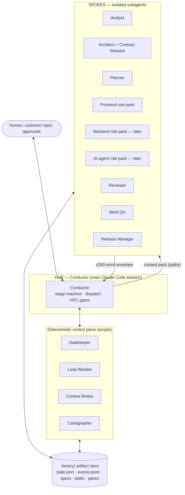

# AI Factory — proposal for a hub-and-spoke multi-agent SDLC pipeline

> Status: **proposal / design suggestions** — no implementation yet.
> Scope of v1: **frontend** tasks. Designed so **backend** and **AI-agent** roles plug in later without changing the orchestrator.
> Harness: **Claude Code first**, Cursor best-effort. Intake: **local files**. Delivery: **GitHub PR**.

## What this is

A design for an "AI factory": a pipeline of specialised Claude Code agents that takes raw customer / user input and carries it through every SDLC step — requirements, stories, (optional) prototype, architecture, planning, implementation, verification, QA — up to an opened pull request, with humans approving at three decisive points.

It must handle three situations with **one** lifecycle:

| Case | Example | Where |
|---|---|---|
| **Greenfield** | "Build a booking app" from a boilerplate, feature by feature | [04](04-entry-modes-greenfield-brownfield.md) |
| **Brownfield-extend** | An app we built earlier (same architecture) gets 3 new features — detect what exists, extend, don't rewrite | [04](04-entry-modes-greenfield-brownfield.md) |
| **Change request** | "The checkout must support coupons" — modify an existing feature safely | [04](04-entry-modes-greenfield-brownfield.md) |

## The architecture in one picture

**One sentence:** a thin conductor in the main session walks a configurable stage machine, dispatching single-purpose spoke agents that communicate only through schema-validated files on disk, while *scripts — not models — decide pass/fail, retries and when to stop.*

## Reading order

| # | File | Read it to understand |
|---|---|---|
| 00 | [Lessons from app-dev-kit](00-lessons-from-app-dev-kit.md) | What exists today, what to keep, what to stop doing |
| 01 | [Principles](01-principles.md) | The rules every later decision follows |
| 02 | [Architecture](02-architecture.md) | Layers, hub-and-spoke, control plane, Claude Code primitives |
| 03 | [SDLC pipeline](03-sdlc-pipeline.md) | Stages, gates, stage→agent→artifact table |
| 04 | [Entry modes](04-entry-modes-greenfield-brownfield.md) | Greenfield vs brownfield vs change request |
| 05 | [Agents and roles](05-agents-and-roles.md) | Core roster, role packs, stack packs |
| 06 | [Artifacts and contracts](06-artifacts-and-contracts.md) | `.factory/` layout and every hand-off schema |
| 07 | [Context engineering](07-context-engineering.md) | How context stays small as the app grows |
| 08 | [Parallelism and flow](08-parallelism-and-flow.md) | Kanban vs Agile, worktrees, FE/BE in parallel |
| 09 | [Quality gates and loop control](09-quality-gates-and-loop-control.md) | Gates, retries, escalation, QA |
| 10 | [Configuration and extensibility](10-configuration-and-extensibility.md) | `factory.config.yaml`, adding a role, packaging |
| 11 | [Delivery and feedback](11-delivery-and-feedback.md) | Branches, commits, PR, review-comment loop |
| 12 | [Observability and evals](12-observability-and-evals.md) | Events, metrics, golden-ticket evals |
| 13 | [Roadmap](13-roadmap.md) | Phased build order with success criteria |
| 14 | [Risks and open questions](14-risks-and-open-questions.md) | What can go wrong, what is still undecided |
| 15 | [Walkthrough and estimates](15-walkthrough-and-estimates.md) | One real task through every stage; time, tokens and the optimisation pass |
| 16 | [Runbook](16-runbook.md) | What to type, step by step: existing app, new app, small fix; stop and resume |

Short on time? Read **README → 16 → 03 → 15 → 13**.

## Requirement traceability

Every requirement from the brief maps to where it is addressed:

| Requirement | Addressed in |
|---|---|
| Cover SDLC from customer requirements to PR | [03](03-sdlc-pipeline.md), [11](11-delivery-and-feedback.md) |
| Hub-and-spoke with a top-level orchestrator | [02](02-architecture.md#hub-and-spoke), [05](05-agents-and-roles.md) |
| Frontend first, scalable to other developer roles | [05](05-agents-and-roles.md#role-packs), [10](10-configuration-and-extensibility.md#adding-a-role) |
| Extendable and configurable | [10](10-configuration-and-extensibility.md) |
| Build from scratch using boilerplates | [04](04-entry-modes-greenfield-brownfield.md#mode-1--greenfield) |
| Extend existing apps without rewriting | [04](04-entry-modes-greenfield-brownfield.md#mode-2--brownfield-extend), [07](07-context-engineering.md#capability-index) |
| Agile or Kanban | [08](08-parallelism-and-flow.md#flow-policies) |
| FE and BE developers in parallel (worktrees) | [08](08-parallelism-and-flow.md#parallel-role-tracks) |
| Each step handled by the appropriate developer agent | [05](05-agents-and-roles.md), [03](03-sdlc-pipeline.md#stage-table) |
| AI-agent implementation tasks handled "the same way" | [05](05-agents-and-roles.md#role-packs), [10](10-configuration-and-extensibility.md#adding-a-role) |
| Stop at any step and continue later | [02](02-architecture.md#the-conductors-loop-one-factorynext), [09](09-quality-gates-and-loop-control.md#preconditions), [06](06-artifacts-and-contracts.md) (`state.json`) |
| Tasks routed by developer role | [06](06-artifacts-and-contracts.md#task-dag--the-routing-seam), [10](10-configuration-and-extensibility.md#adding-a-role) |
| Optimised context and shared files | [07](07-context-engineering.md) |
| How the user's input starts the pipeline | [03](03-sdlc-pipeline.md#starting-a-run-how-context-gets-in) |
| Test-first (TDD) implementation | [03](03-sdlc-pipeline.md#test-first-two-nested-loops), [09](09-quality-gates-and-loop-control.md#independent-tests) |
| Evals for agents and skills | [12](12-observability-and-evals.md#three-eval-layers) |
| Real-life walkthrough, time and cost per run | [15](15-walkthrough-and-estimates.md) |
| Start a run on an existing app with new requirements | [16](16-runbook.md#a-modify-an-existing-app-with-new-requirements-most-common) |
| Code review and documentation after implementation | [03](03-sdlc-pipeline.md#code-review-and-documentation-after-implementation), [09](09-quality-gates-and-loop-control.md#review-design) |
| Agile (Scrum) or Kanban recommendation | [08](08-parallelism-and-flow.md#which-one-to-choose) |
| How requirements are converted | [06](06-artifacts-and-contracts.md#requirements-lifecycle) |
| Reference architectures per role (frontend architecturev2, backend layered, agent LangGraph) | [10](10-configuration-and-extensibility.md#reference-architectures) |
| Which plugins to build; configurable and maintainable packaging; no sub-orchestrators | [10](10-configuration-and-extensibility.md#packaging), [02](02-architecture.md#no-sub-orchestrators) |
| Context not summarised away or lost between layers | [07](07-context-engineering.md#where-context-can-be-lost-and-what-catches-it) |

## Glossary

| Term | Meaning |
|---|---|
| **Conductor** | The hub. Runs in the main Claude Code session; owns the stage machine, dispatch and human gates. Never writes product code. |
| **Spoke** | A subagent with one responsibility, scoped tools and an isolated context. |
| **Control plane** | Deterministic scripts (Gatekeeper, Loop Warden, Context Broker, Cartographer) that the Conductor calls. |
| **Stage pack** | Plugin that ships the core agents and skills for a group of stages (`factory-analysis`, `factory-quality`, `factory-delivery`), declared in `stage.yaml`. |
| **Role pack** | Plugin that knows *how to execute* a task type (frontend / backend / ai-agent): agents + task procedures + gates, declared in `role.yaml`. |
| **Stack pack** | Plugin that knows *a technology stack* (`frontend-dev-kit`, `node-backend-dev-kit`, `node-agent-dev-kit`): rules + skills + golden files + boilerplate, declared in `stack.yaml`. |
| **Track runner** | The headless runner started once per role worktree for parallel FE / BE work — the same engine, not a nested orchestrator. |
| **Human note** | An instruction you give at a gate or with `/factory:note`, stored as `HD-*` so it can't be lost to compaction. |
| **Context pack** | A file materialised per dispatch that lists exactly what a spoke may read — paths, not payloads. |
| **Envelope** | The structured ≤200-word result a spoke returns to the Conductor. |
| **Gate** | A pass/fail check. *Machine gates* are scripts; *human gates* (HITL) are approvals. |
| **Delta-spec** | ADDED / MODIFIED / REMOVED accounting of a change against existing behaviour. |
| **Capability index** | Machine-maintained map of an app: features, routes, modules, reusable components. |
| **Feature ledger** | Append-only record of every feature delivered: spec, tasks, PR, tests. |
| **HITL** | Human-in-the-loop gate. |
