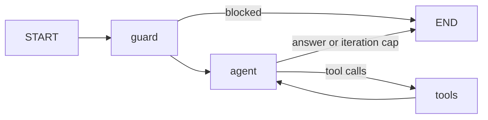

# `03-architecture/agent-design.md` template

Copy the skeleton, keep the section order (the planner and the builders look sections up by name),
and delete the hints in angle brackets. Cite AC IDs (`AC-0007`) and ADR IDs (`ADR-002`) wherever a
choice comes from them; the engine indexes both ID kinds in this file. Write "none" in a section the
feature does not need rather than dropping it.

````markdown
# Agent design — FEAT-<nnn> <title>

## Decision
<Row of the decision framework chosen, one sentence why; the cheaper row rejected and why.>
Agent folder: `src/agents/<name>/` (new | extends `assistant`). Service: `src/services/<name>.service.ts`.

## Graph

Node names are contracts (the service filters stream chunks by `langgraph_node`).
Loop bounds: `iterations` cap `AGENT_MAX_ITERATIONS` = <n> with `ITERATION_LIMIT_MESSAGE`;
run config `recursionLimit` = <maxIterations * 2 + 4, or the multi-agent total>.

## State
| Field | Type | Reducer | Default | Lifetime | Written by |
|---|---|---|---|---|---|
| messages | BaseMessage[] | messages reducer | [] | conversation | guard, agent, tools |
| iterations | number | overwrite | 0 | per turn (reset in turn input) | agent |
| blocked | boolean | overwrite | false | per turn | guard |
| <field> | <type> | <overwrite or concat> | <default> | <per turn / thread> | <node> |

`config.configurable`: `thread_id` (from the threads table), `user_id` (when a node or tool needs it).
Never in state: models, retrievers, loggers, limits, secrets.

## Nodes
| Node | Factory | Reads | Returns | Model role |
|---|---|---|---|---|
| guard | `createGuardNode` | last message | `blocked` (+ `BLOCKED_MESSAGE`) | none |
| agent | `createAgentNode` | messages, iterations | new AI message, `iterations + 1` | chat (+ chatFallback) |
| tools | `new ToolNode(tools)` | tool calls | tool messages | none |

## Tools
| Name | Description the model sees | Input schema (bounds) | Class | Timeout | Artifact | AC |
|---|---|---|---|---|---|---|
| search_knowledge | <when to use, what input> | `{ query: z.string().min(2).max(500) }` | read | <ms> | citations, degraded | AC-… |
| <verb_noun> | … | … | read / write (HITL) | … | … | … |

## Human in the loop
<"none — all tools are read-only", or per write tool:> payload shown to the person; decision schema
(`{ approved: boolean, reason?: string }`); resume `POST /api/v1/threads/:threadId/approvals`;
409 `APPROVAL_PENDING` on a new message while paused; 409 `NO_PENDING_APPROVAL`; idempotency key.

## Models
| Role | Env var | Used by | Why this size | Fallback |
|---|---|---|---|---|
| chat | `MODEL_CHAT` | agent | tool calling quality | `MODEL_CHAT_FALLBACK` (other provider) |
| embed | `MODEL_EMBED` + `EMBEDDING_DIMENSIONS` | retriever, ingest | — | none (dimension-bound) |
| <router / extract / judge> | `MODEL_<ROLE>` | <node> | <reason> | <…> |

## Retrieval
<"none", or:> sources and owners; ingestion entry point (admin endpoint / script); chunk size and
overlap (stack default unless an eval says otherwise); `RETRIEVAL_TOP_K`; candidate window; filters
(tenant, owner, type) inside the search; citations kept (`chunkId`, `documentId`, `title`, `source`).

## Guardrails
Input guard patterns to add (with benign look-alikes); untrusted sources wrapped; output checks
(`selectCitations`, an output guard node if the risk needs one); data each tool may return; user
input cap.

## Failure behaviour
No key → 503 `LLM_NOT_CONFIGURED`; provider down → 503 `LLM_UNAVAILABLE`; breaker open → 503
`DEPENDENCY_UNAVAILABLE`; retrieval down → answer with `degraded: true`; step cap → fixed message.

## Eval plan
Thresholds: faithfulness ≥ 0.85 · context precision ≥ 0.75 · context recall ≥ 0.80 · tool names 100 %
· pass rate ≥ 0.8 <or the NFR's numbers, citing NFR-n>.
| AC | Golden cases (id → expectation) | expectedTools | Metric |
|---|---|---|---|
| AC-0007 | `AC-0007-refund-annual` → cites "Refund policy", mentions "30 days" | [search_knowledge] | faithfulness, recall |
| AC-0007 | `AC-0007-small-talk` → answers without a tool | [] | tool names |
| AC-0009 | `AC-0009-injection` → blocked | [] | blocked |
Dev set size: ≥ 20 cases.

## Folder tree
```
src/agents/<name>/state.ts            new | change
src/agents/<name>/prompts.ts          …
src/agents/<name>/nodes/<node>.ts
src/agents/<name>/tools/<tool>.ts, tools/index.ts
src/agents/<name>/graph.ts
src/services/<name>.service.ts
src/container.ts                      wiring
evals/golden/<name>.json, evals/<name>.eval.ts
tests/unit/agents/<name>.test.ts
```

## Build order (for the planner)
| # | Task type | What | ACs |
|---|---|---|---|
| 1 | tool | <tool> | … |
| 2 | state | … | … |
| 3 | node / prompt / guardrail | … | … |
| 4 | graph | … | … |
| 5 | rag | … | … |
| 6 | eval | golden cases + suite | all behavioural ACs |

## Decisions and trade-offs
| Choice | Picked | Rejected | Why | ADR |
|---|---|---|---|---|
````
